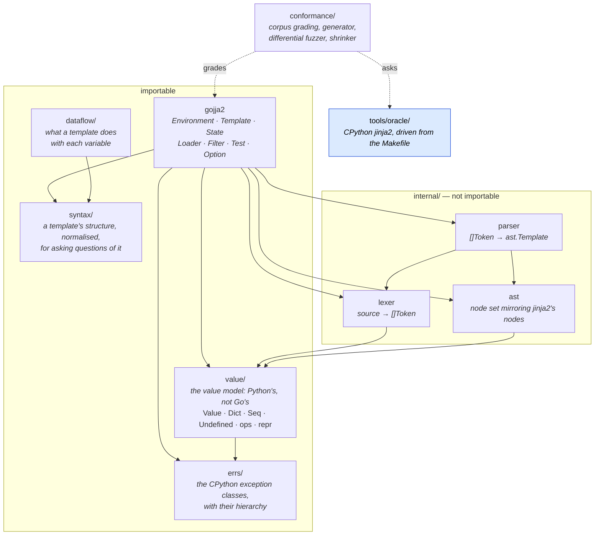
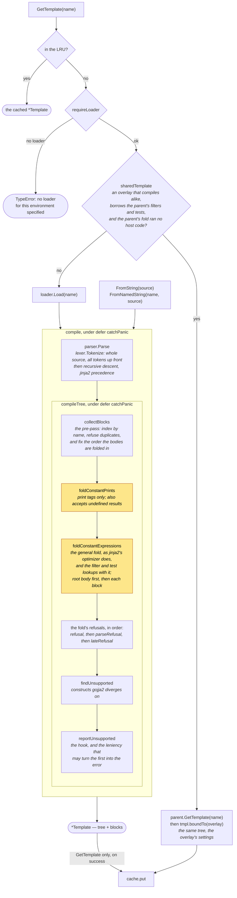
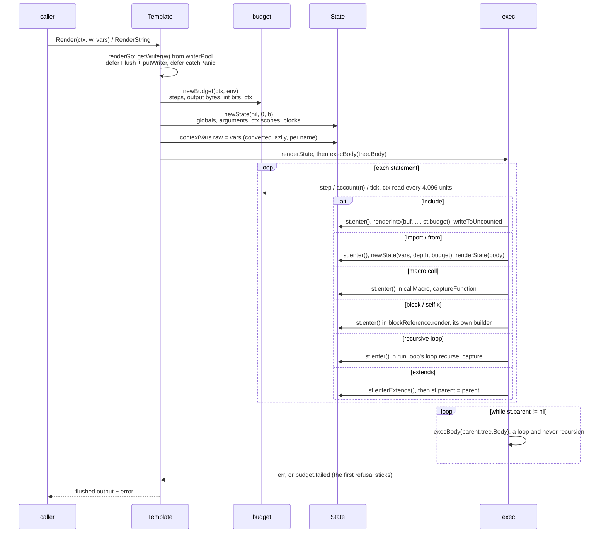
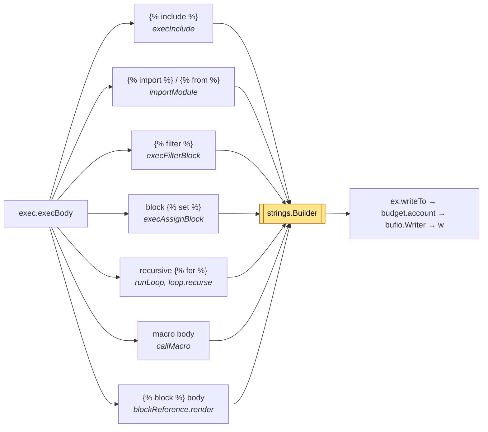
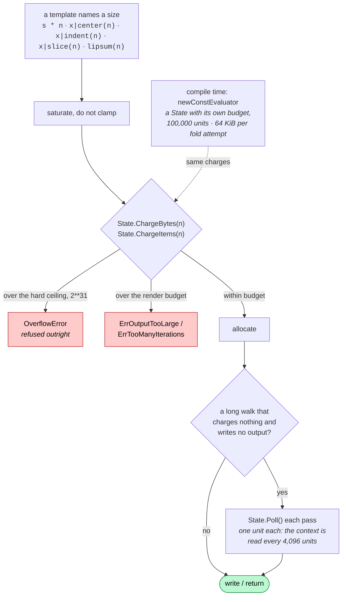
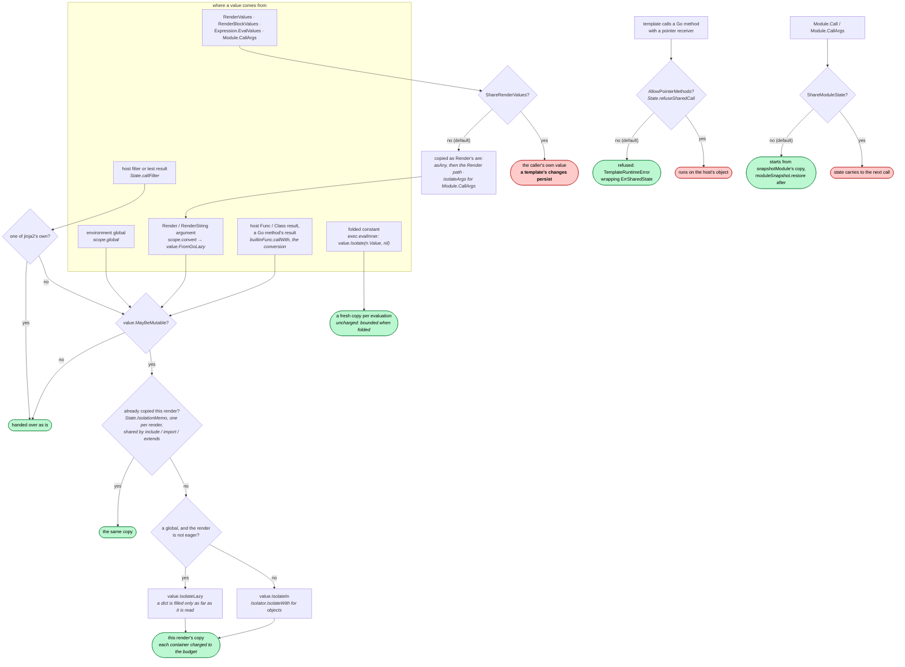

# How a template gets rendered

This is the map you want before changing anything. It covers the two paths a
template takes — compile, then render — the six ways a render nests into
another one, the rule every allocation obeys, and what a render may not leave
behind.

Code is named by function rather than by `file:line`, because line numbers
drift and function names are what `grep` and `go doc` find.

It is deliberately short on prose. The shapes are the point: two of the four
Critical findings in the [2026-09-16 audit](audits/codebase-audit-2026-09-16.md)
were *shape* bugs, and both were found by drawing the second diagram below as a
table and noticing which rows disagreed.

## The packages

A solid arrow is an import (`go list -deps`), not the order data flows in.
`value/` and `errs/` are importable because a caller writing a filter or a custom
object needs them — see [extending.md](extending.md). `syntax/` is what
`Template.Syntax` returns, a tree built for questions rather than for
evaluation, and `dataflow/` answers questions over it without importing the
engine at all. `internal/` is not importable: the token stream and the parse
tree are graded against jinja2's own, which makes them a specification to
conform to rather than an API to depend on.

## Compiling

`CompileExpression` joins this path at `compileTree`, with a tree it built
itself. The amber boxes are run by one `constEvaluator` per compile, made by
`newConstEvaluator`; it records in `foldsHostCode` whether a fold ran a filter
or test the host registered, which is what stops an overlay reusing that
template (a host function is handed the compiling environment's `State`).

Four things about this path catch people out.

**The order of what those boxes do is observable.** A fold that refuses ends the
compile, and so does an unknown filter name, so which of two broken expressions
is named depends on which is reached first — and jinja2 does both from its *code
generator*, node by node, rather than in passes of its own. Three consequences
are reproduced in the fold and in the dependency check alike: a block's body is
handled after the whole root body (and blocks in the order the pre-pass
collected them, not where they are written); a print tag below a root-level
`` is not handled at all, because the generator leaves it out
rather than guarding it — `{{ 1|nosuch }}` renders the
parent; and a duplicate block name, collected before a line is generated, beats
both. `fold/order_*` and `fold/generated_*` in the corpus grade each one.

That is also why the fold and the dependency check are one walk rather than
two. jinja2 folds an expression and looks its filters up as it writes that one
node out, so `{{ 1|nosuch }}{{ (0 ** 0)[7] and 0 }}` names the filter and the
same two swapped name the subscript; two passes cannot do that, however
carefully their walks are kept in step. The order inside a statement is the
generator's too, and it is not the order the tag is written in: a loop's test
becomes a function of its own, written before the loop that calls it, and a
``, a `` with a body and a `` all buffer their
body first and write what consumes it afterwards. `fold/order_within_*` and
`fold/order_mixed_*` grade those.

**Compilation takes no `context.Context`, and the render's bounds do not apply
to it.** The bounds in [limits.md](limits.md) are *render* bounds. What protects
compile time instead is the parser's 1,000-level nesting cap and the fold's own
budget: 100,000 units of work and 64 KiB of output per fold attempt, and no
folded constant over 64 KiB — the amber boxes run real filters, including the
host's, so they are the part that can do arbitrary work. A fold that runs out
is declined and the expression is left to the render
([limits.md](limits.md#a-budget-on-constant-folding)).

**Only `GetTemplate` caches**, and only on success. `FromString` compiles every
time, which is why it is the wrong thing to call in a loop.

**An unknown filter is not always a compile error.** jinja2 reports one at
compile time, except inside an `` or an inline conditional, where the
name is looked up when the branch runs -- which is what lets a template name a
filter only some deployments register. The exemption reaches exactly as far as
the code jinja2 emits inline: a ``, ``, ``,
``, ``, ``, `...` or
`` gets a frame of its own, and a name inside one is refused
when the template compiles however many untakeable branches enclose it. `depcheck.go`
carries the same rule, graded by the `errors/unknown_filter_{soft,hard}_*` cases.

## Rendering, and the six ways it nests

`RenderValues`, `RenderBlockValues` and `Expression.EvalValues` take the same
path as `Render`, through `renderGo`, `RenderBlock` and `Eval`, unless the
environment has `ShareRenderValues`; then they hand their values straight to
`newState` (`renderInto` for `RenderValues`). `Template.Module` and
`Expression.Eval` mark their render `eager`, since what they return outlives
it ([below](#what-a-render-may-not-leave-behind)).

The six routes are written separately, and that is where the bugs were. What
each one does with the three things that must not be dropped:

| construct | new `State`? | budget threaded | depth counted | output |
|---|---|---|---|---|
| `` | yes, via `renderInto` | yes | `st.enter()` | **buffered in full**, then written on |
| `` | no — same `State` | yes | `st.enterExtends()` | parent body replaces the child's |
| `` / `` | yes, `tmpl.newState(vars, depth, budget)` | yes | `st.enter()` | buffered in full; kept as the module's `str()` |
| a macro call | no — same `State` | yes | `st.enter()` | captured, `captureFunction` |
| `` / `self.x` | no — same `State` | yes | `st.enter()` | its own builder, in `blockReference.render` |
| a recursive ``'s `loop(...)` | no — same `State` | yes | `st.enter()` | captured, `ex.capture` |

Every row now threads the budget and counts the depth. Two used not to, and this
table is how you would have seen it: `` built its `State` by hand and never
copied the budget, so an imported template rendered with *no* bound and no
context at all — not a fresh allowance, none — and `` never entered
the depth counter, so `{{ self.x }}` recursed until
the goroutine stack was exhausted. A Go stack overflow is a fatal error rather
than a panic, so `catchPanic` never saw it and the process died.

**When you add a seventh route, fill in this row first.**

### What holds output before writing it

Seven constructs hold their own body rather than streaming it. Peak memory
tracks the largest of them, not the write buffer.

A filter, an assignment and a function each need finished text before they can
act on it, so each buffers. ``, block `` and the recursive
`` use `capture`; the macro body uses `captureFunction`, which also
moves the *stream*, because a body is a function and not merely a buffer. A
block body is a function too: `blockReference.render` builds an `exec` whose
output and stream are both a builder of its own. An include renders the whole
included template into a builder before writing it on, and an import renders
the imported template's whole body, which it keeps as the module's `str()`.
The stream distinction is what makes `` escape
an enclosing `` — it writes to `ex.stream` rather than `ex.out`,
reproducing a jinja2 quirk that the differential fuzzer found.

Output is charged against the budget wherever it lands, so text that passes
through two buffers is counted twice. The buffers are the memory the bound
exists to protect, so they are what has to be counted.

## Charge before you allocate

Every size a template chooses goes through this, and getting it wrong is the
single most repeated defect in this codebase's history.

Four rules, each of which has been broken at least once:

1. **Charge first.** Charging after the allocation charges for memory that is
   already gone.
2. **Charge the total, before splitting it.** Guards do not compose:
   `("a"*60000)|replace("a","b"*60000)` passed every individual guard and
   allocated 3.6 GB, and `center` charged its two halves separately, each of
   which cleared the ceiling while their sum did not.
3. **Saturate, never clamp.** Clamping a huge count down to the ceiling turns
   "refuse" into "allocate the maximum" — the same failure shape as an overflow
   wrapping negative and reading as a tiny allocation.
4. **Compile time is not exempt.** Constant folding runs real filters, with its
   own budget, reset per fold attempt — folding is observable, so it must not
   depend on how many expressions preceded it.

The hard ceiling sits *above* the budget because a caller can remove the
budget -- internally, a `budget` whose `maxSteps` or `maxOutput` is zero or
negative counts but never refuses, which is what `WithoutLimits()` sets -- and
unbounded must still not mean "allocate 2\*\*63 bytes".

`conformance/budget_test.go` grades this generatively, and found two of the four
on its first run.

## What a render may not leave behind

A compiled `*Template` is shared by every render of it, every goroutine, and,
through overlays, every tenant. jinja2 lets a template change what it was
handed -- `` appends to the caller's list -- so one render
can change what the next one sees. gojja2 does not, by default: each render
works on its own copy of anything from outside it that a template could change,
copied the first time the render reaches it. `WithSharedState` gives back
jinja2's behaviour one piece at a time; shared.go has the flags, and
[extending.md](extending.md) what this asks of host code.

Three things about it are easy to get wrong.

**What can change is decided without walking.** `value.MayBeMutable` answers
from the kind alone: a list, a tuple, a dict, a set, or an `Object` that
implements `value.Isolator`. Strings, numbers, Markup and everything else are
handed over as they are and cost nothing. A host `Object` that does not
implement `Isolator` is therefore never copied, whatever it does when called.

**One copy per render, not per reference.** The memo lives on the budget
(`budget.isolated`), the one thing every `State` of a render shares, so a
global reached from an include and from the template that included it is the
same copy, and an append through one is seen through the other, as in jinja2.
A global is copied lazily (`State.isolateGlobal`), because the original
outlives the render and nothing else changes it. A render whose values go back
to the host -- `Template.Module`, `Expression.Eval` -- is `eager`, and copies
and converts in full, so nothing is filled in later against a budget whose
context may be gone.

**Some things are copied whatever the flags say.** `ShareAll` is all three
flags, not jinja2's behaviour throughout: an environment global, a `Render`
argument and what a host function returns are copied regardless, because a
render that changed them would change them for every render after it. What
no flag covers is code the engine cannot see into -- a host filter, test,
`Func` or `Object`, and a value-receiver Go method that writes through a map, a
slice or a pointer its struct holds. Those run as written.

## Where the specification lives

Nowhere in this repository. CPython `jinja2`, pinned in `.venv`, is the
specification; `tools/oracle/` drives it and `conformance/` grades against it.
See [conformance.md](conformance.md) for the corpora and the numbers, and
[contributing.md](contributing.md) for what to do when the two disagree.
