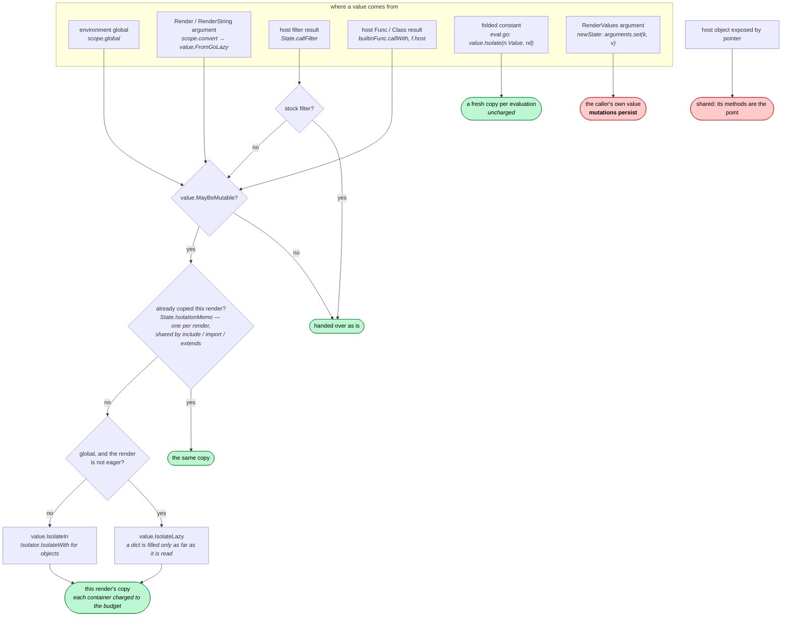
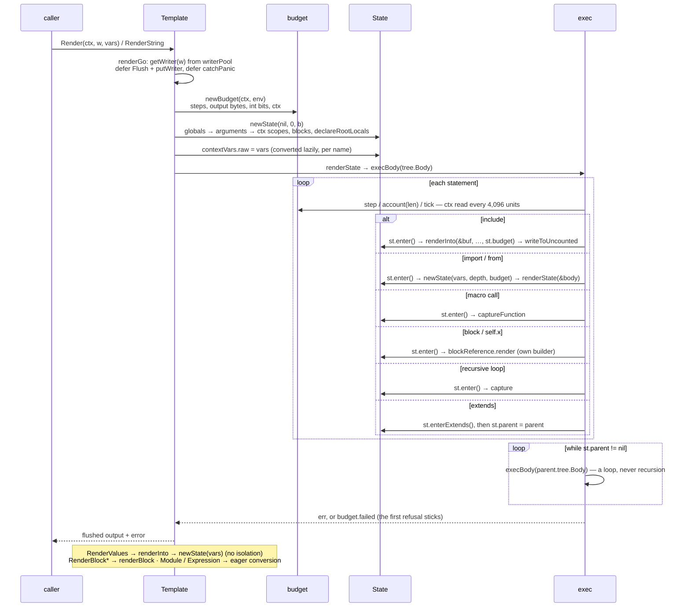
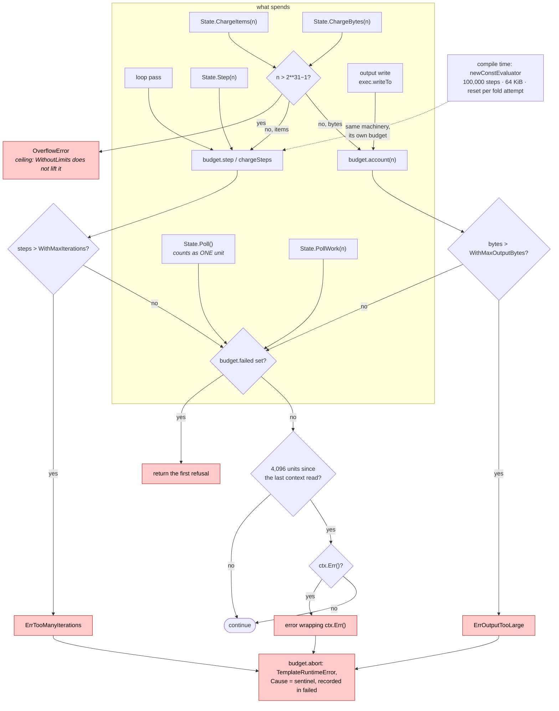
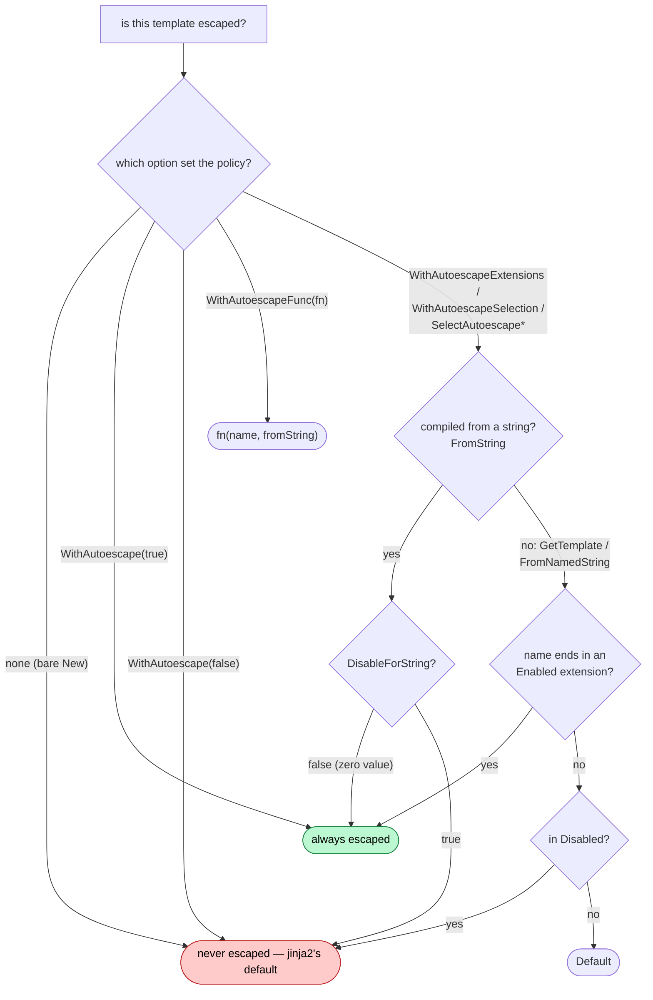
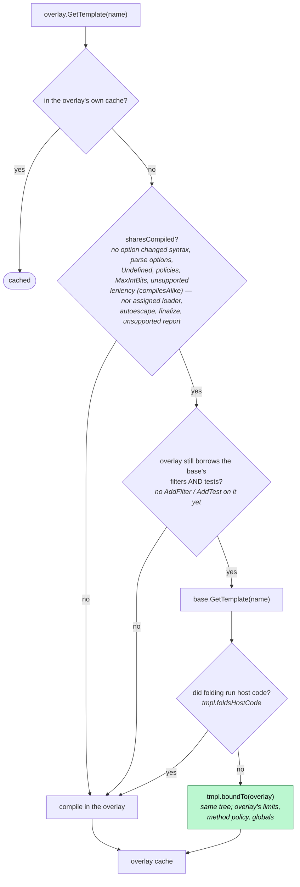

# Documentation audit — 2026-10-11

Taken at `c09f2238` (main, clean tree). This is a snapshot, not a specification:
see [README.md](README.md) for the convention. It supersedes
[docs-audit-2026-09-18.md](docs-audit-2026-09-18.md), whose 23 findings are re-run
in [section 8](#8-the-2026-09-18-findings-re-run).

**What it covers.** Every reader-facing surface, read in full: `README.md`, every
file in `docs/`, `NOTICE`, the Makefile's comments and `make help`, the three
workflows, `tools/**` headers and `--help`, `testdata/known_failures.txt`, the
generated corpora's `SOURCES.md`, package and exported-symbol godoc for `gojja2`,
`value`, `errs`, `syntax` and `dataflow`, every runnable example, and all nine
Mermaid diagrams.

**The headline.** Most of the docs are accurate, routed and well written, and the
four doc guards in `docs_test.go` work: each of the ten defects planted for them
made it fail. The problems sit where the guards do not reach, and seven of them
are High:

- three docs describe a security property more strongly than the code provides
  (D1, D2, D4);
- one documented extension contract is no longer how the engine calls you (D3);
- one undocumented divergence changes what a working template renders (D5);
- the fork-PR gate the docs describe does not trigger the way they say (D6);
- the CPython-version figures are stale in five places (D7).

**Counts:** 39 findings — **7 High**, **23 Medium**, **9 Low**. 31 are
CONFIRMED by a command whose result is recorded below. 8 are PLAUSIBLE, or contain
a PLAUSIBLE part that is marked where it occurs.

Severity scale:

- **High:** a reader following the doc ships a security or correctness defect,
  or the doc's main claim is false.
- **Medium:** a reader is misled or blocked on a real task.
- **Low:** friction, a cosmetic error, or a small factual slip.

---

## 1. Summary

| ID | Sev | Document | Issue | Status |
|---|---|---|---|---|
| D1 | High | guide.md, extending.md, README.md | `RenderValues` lets a template mutate caller data across renders; guide says nothing a render changes reaches the host, and extending steers readers to `RenderValues` | CONFIRMED |
| D2 | High | README.md, guide.md | "A template compiled with `FromString` is escaped" — false on a bare `New()`; only true under a selection policy | CONFIRMED |
| D3 | High | extending.md, architecture.md, limits.md, `Func`/`ChargeBytes` godoc | A host filter/test with constant arguments is run **once at compile time** and its result baked into every render; docs say "State is nil during folding" and "compilation has no budget" | CONFIRMED |
| D4 | High | README.md, guide.md, limits.md, extending.md, `Template.Render` godoc | The context is sampled every 4,096 units, not at "the next loop pass"; a short render succeeds against a cancelled context, and the `Poll` advice defeats itself | CONFIRMED |
| D5 | High | divergences.md | `|batch` and `|slice` are generators in jinja2 — `` renders differently — and no doc says so; "one divergence worth looking for" is now two | CONFIRMED |
| D6 | High | README.md, contributing.md | `safe-to-test` label is said to release CI, but `pull_request` has no `labeled` type; push/strip race | CONFIRMED (trigger) / PLAUSIBLE (race) |
| D7 | High | README, guide, conformance, `compat.go`, `value/pyversion.go` | Version figures "66 of 2,241", "sixteen rules", "97.1%/98.3%", "78 files" are stale: today 288 of 5,836, 25 rules, 331 files | CONFIRMED |
| D8 | Med | README.md, conformance.md, contributing.md | "TestConformance fails the build" on drifted figures — the check skips without imported corpora, and no workflow builds them | CONFIRMED |
| D9 | Med | README, contributing, Makefile | "`make check` is everything CI runs" — CI also fuzzes 4×60 s and runs Windows/macOS (regression of 09-18 D10) | CONFIRMED |
| D10 | Med | limits.md, `RecursionMessage` godoc | Recursion-wording section describes CPython 3.11; on the default 3.13 every route says plain "maximum recursion depth exceeded" | CONFIRMED |
| D11 | Med | guide.md:427 | `syntax.Walk(tmpl.Syntax(), …)` does not compile (`Syntax()` returns `*syntax.Tree`) | CONFIRMED |
| D12 | Med | divergences.md:13-26, :144-146 | "Where jinja2 raises and gojja2 renders" holds four entries where CPython renders and gojja2 refuses; intro undercounts templates that render differently | CONFIRMED |
| D13 | Med | divergences.md | 43 sections vs "forty-two"; NaN row missing; two divergences unlisted; ~6 entries have no asserting test despite "each one is asserted by a test" | CONFIRMED |
| D14 | Med | divergences.md:598, :648 | `|pprint` claims wrong for a short set (hash order) and a small cyclic value (prints an id) | CONFIRMED |
| D15 | Med | architecture.md | 7 stale `file:line` refs; six nesting routes not five; `syntax`/`dataflow` missing from package map; compile diagram misses refusal and report steps; no isolation section | CONFIRMED |
| D16 | Med | limits.md:33 | "To remove one, pass a negative value" — `WithMaxRecursion(-1)` still caps at 100 | CONFIRMED |
| D17 | Med | limits.md:67, `WithMaxIntBits` godoc | Width limit is an operand estimate: `2 ** 600000` refused as 1.2 M bits | CONFIRMED |
| D18 | Med | dataflow/example_test.go, docs/README.md | `ExampleAnalyze` never runs (`// Output:` inside a comment group); "examples cannot drift" | CONFIRMED |
| D19 | Med | guide.md:611 | `WithPolicies` replaces the whole struct; a partial struct silently drops `rel="noopener"` | CONFIRMED |
| D20 | Med | contributing.md:575-620 | Oracle-workflow prose stale (value-depth never regenerated; differential job and monthly mutate omitted); schedules/platforms undocumented | CONFIRMED |
| D21 | Med | conformance.md:255-360 | Differential diagram and axis list stale: second-oracle reproducibility, drawn context/template/policy sets; "eleven" vs "eleventh" | CONFIRMED |
| D22 | Med | conformance.md, README, NOTICE, docs/README | "Each generated corpus carries a `SOURCES.md`" — minijinja and jinja-harvest do not | CONFIRMED |
| D23 | Med | contributing.md:142-573 | ~430 lines of lab-notebook history inside a how-to | CONFIRMED (structure) |
| D24 | Med | divergences.md | 1,500 lines, four audiences in one file | CONFIRMED (structure) |
| D25 | Med | guide.md | Template analysis (190 lines) buries policies/overlays/concurrency; Concurrency is last; Overlays mixes four modes | CONFIRMED (structure) |
| D26 | Med | many | Same fact in 3-8 places (pins, versions, upstream count, CI, setup, caps) — the source of D7, D9 | CONFIRMED |
| D27 | Med | guide.md, extending.md | Public API with no prose: `CompileExpression`, `ListTemplates`, `LoaderFunc`, `WithAutoescapeFunc`, `Class`/`Method`, `value.Isolator`, `errs.Error` fields | CONFIRMED |
| D28 | Med | contributing.md | Contributor surface undocumented: prerequisites, `known_failures.txt` format, `case()` reserved keys, env vars, tool exit codes | CONFIRMED |
| D29 | Med | (none) | No troubleshooting / runbook anywhere | CONFIRMED |
| D30 | Med | limits.md | Missing: budget errors are `TemplateRuntimeError`; first refusal sticks; fold budget; folded constants uncharged; recursive `for` counted | CONFIRMED |
| D31 | Low | extending.md | `ChargeBytes(2<<30)` example refused on first call; wrong interface names; `len(range(…))` example raises; "two definitions" are three | CONFIRMED |
| D32 | Low | divergences.md | Small slips: `range['k']`, `slice(0)` and codec examples, wrong link, four wrong "above/below", error class, unsourced counts | CONFIRMED / PLAUSIBLE (counts) |
| D33 | Low | contributing.md | "Today 49 of 439" and "45 of 393" — measured 51 of 441; 4,715 cases; "nine files" is ten; stray fragment | CONFIRMED |
| D34 | Low | Makefile, README | `make help` omits `suites`/`utf8`; `make lint` not pinned; "Ten upstreams" lists eleven | CONFIRMED |
| D35 | Low | guide.md | Unqualified `Undefined*` constants; pointer-receiver caveat; listing order ≠ json; benchmark table drifted | CONFIRMED |
| D36 | Low | docs/README.md, README.md | Routing gaps (analysis, overlays, isolation, version, CI); `go doc State` advice; pkg.go.dev links | CONFIRMED / PLAUSIBLE (404) |
| D37 | Low | godoc, tool headers | Package comment is one sentence; two misattached doc comments; stale "only the differences" headers; oracle.py "two keys" lists three | CONFIRMED |
| D38 | Low | docs_test.go | Guard blind spots: reference links, titled links, `<a href>`, dotted godoc syntax, self-linked orphan | CONFIRMED |
| D39 | Low | docs-audit-2026-09-18.md | Re-run: D10 regressed; D6, D11, D18, D23 partially regressed | CONFIRMED |

---

## 2. Doc map

### Current

| Doc | Lines | Mode | Reader | Found from |
|---|---|---|---|---|
| `README.md` | 196 | front door | evaluator, new user | repo root |
| `docs/README.md` | 83 | index + glossary + "where a fact lives" | anyone | README nav bar |
| `docs/guide.md` | 721 | how-to + reference + explanation | Go caller | README, index |
| `docs/extending.md` | 287 | how-to + contract | filter/type author | README, index, guide |
| `docs/limits.md` | 409 | reference + explanation + history | operator, filter author | index, guide |
| `docs/divergences.md` | 1,500 | reference + explanation + API map | template porter, deployer, jinja2-API user | README, index |
| `docs/scope.md` | 71 | explanation | evaluator | README, index |
| `docs/architecture.md` | 243 | explanation + diagrams | engine contributor | index |
| `docs/conformance.md` | 399 | explanation + reference | evaluator, contributor | README, index |
| `docs/contributing.md` | 706 | how-to + 430 lines of history | contributor | README, index |
| `docs/audits/*` | — | snapshots | maintainer | index |
| godoc | — | reference | Go caller | `go doc`; pkg.go.dev (PLAUSIBLY unavailable, D36) |

Not found by a newcomer: `testdata/known_failures.txt` format, `tools/*` exit codes,
the env vars in D28, and the CI matrix, which exists only in YAML comments.

### Proposed

Each change below is justified by the finding cited.

```
README.md                      front door (unchanged shape; fix D2, D4, D1 bullets)
docs/README.md                 index — add the rows in D36
docs/guide.md                  HOW-TO, Go caller: load, render, values, errors,
                               undefined, autoescape (+diagram), syntax, New refuses,
                               concurrency & isolation (moved up), "Using a template
                               from Go" (RenderBlock, Module, CompileExpression)   [D25, D27]
docs/analysis.md       NEW     HOW-TO+EXPLANATION, tooling author: Template.Syntax,
                               ReferencedTemplates, Info, dataflow  (guide.md:418-609) [D25]
docs/multitenancy.md   NEW     HOW-TO, deployer: overlays (+reuse diagram), per-tenant
                               limits, what is and is not shared (isolation table from
                               divergences.md:1063-1133, incl. the RenderValues hole) [D1, D25]
docs/extending.md              CONTRACT: add "you may be run at compile time" (D3);
                               full Object interface table incl. Isolator (D27)
docs/limits.md                 REFERENCE first (table with error class, "negative
                               means", fold budget, sampling interval), history last [D16, D30]
docs/divergences.md            REFERENCE, template porter: template-visible only (~700 l.) [D24]
docs/divergences-host.md NEW   host-visible differences (divergences.md:1059-1320)  [D24]
docs/jinja2-api-map.md   NEW   "jinja2 API → gojja2" (divergences.md:1321-1492)      [D24, D27]
docs/introspection.md    NEW   Python object introspection (divergences.md:862-1015) [D24]
docs/python-versions.md  NEW   the ONE home for pins, version rules, version-matrix
                               numbers (from conformance.md:149-253, guide.md:334-367) [D7, D26]
docs/scope.md                  unchanged
docs/architecture.md           EXPLANATION: function names not line numbers; render
                               sequence; isolation section; six nesting routes   [D15]
docs/conformance.md            EXPLANATION: corpora + differential (one section, axis
                               table, refreshed diagram)                          [D21]
docs/contributing.md           HOW-TO (~200 l.): prerequisites, setup, gate, triage,
                               add a case (+known_failures format), golden, send it  [D23, D28]
docs/tooling.md          NEW   REFERENCE: every make target, variable, env var, cap,
                               exit code; CI/oracle job × trigger × platform matrix [D20, D28]
docs/verification.md     NEW   EXPLANATION: syntax byte-equality, binding facts,
                               dataflow negatives, mutate, ungraded (contributing.md:142-573,
                               with pass-by-pass history moved to commit log/audits) [D23]
docs/troubleshooting.md  NEW   RUNBOOK: symptoms → cause → fix                    [D29]
```

Merges: `guide.md`'s three-line "Filter policies" section joins the
autoescape/`New` reference with `DefaultPolicies()` shown (D19). The
`divergences.md:1493-1500` stub repeats lines 28-30 and should be deleted.

---

## 3. Drift verification

Probes ran in throwaway modules under `/tmp/docsaudit-*`, one template per
`systemd-run --user --scope -p MemoryMax=… -p MemorySwapMax=0` invocation. Oracle
calls went through `.venv/bin/python tools/oracle/oracle.py`, one benign case per
capped, `timeout -s KILL`-wrapped process. `go test` ran only under the same cap.
The repo was never modified.

| ID | Check run | Result |
|---|---|---|
| D1 | Probe: `{{ xs }}` rendered twice via `RenderValues` with one `value.NewList(Int(1))`, then twice via `RenderString(map[string]any{"xs": list})` | `RenderValues`: `[1, 9]` then `[1, 9, 9]`. `RenderString`: `[1, 9]` both times. Code: `newState` sets `vars` straight into the argument scope (template.go:451); only `renderGo` goes through lazy conversion and isolation |
| D2 | Probe: `New()` then `FromString("{{ '<i>' }}")`; the same under `WithAutoescapeExtensions(".html")` | `"<i>"` and `"&lt;i&gt;"`. Code: `escapes` is `e.autoescape != nil && …` (environment.go:822); only `SelectAutoescapeWith` returns `!DisableForString` for strings |
| D3 | Probe: host filter `ctr` incrementing a counter; `FromString("{{ 'a'\|ctr }}")` rendered 3× | `"1"`, `"1"`, `"1"`, with calls = 1 in total. Separate probes: `State` at fold time is non-nil; a filter reading `s.Resolve("lang")` lost the context in its constant call; `ChargeBytes(1<<30)` at fold time reported the 65,536-byte fold budget under `WithoutLimits`. Code: `newConstEvaluator`, optimize.go:1236-1260 (`maxFoldSteps = 100_000`, `maxFoldBytes = 64 KiB`, reset per attempt) |
| D4 | Probe: cancelled context; `{{ i }}` | `"0123456789" <nil>`, i.e. success. `range(5000)` is refused. 100 `Poll()` calls under a dead context: success; 5,000: refused. Code: `checkInterval = 1<<12` (limits.go:41) |
| D5 | Oracle: `T\|{{ [1,2]\|slice(1) }}`; gojja2 the same | CPython `T\|<generator object sync_do_slice at 0x…>`; gojja2 `\|[[1, 2]]`. Also: `[1,2]\|batch(1)\|length` is a TypeError in CPython and `2` here |
| D6 | Read ci.yml:13-15 and revoke-approval.yml | `pull_request:` with no `types:`, so the defaults (opened, synchronize, reopened) apply and `labeled` starts no run. The revoke job is `pull_request_target: [synchronize]`, so it starts concurrently with CI's synchronize run (race PLAUSIBLE, not run on GitHub) |
| D7 | `find testdata/corpus -name '*.jj2' \| wc -l`; per-dir `find testdata/golden-3.* -type f`; `sort \| uniq -c` of override names; counted `func (v PythonVersion)` after the rules banner | 5,836 cases. Overrides: 103 + 26 + 202 = 331 files, 288 distinct cases (4.9%); 271 of them answer two ways, 17 three ways. 25 rule methods. Every override differs from the base (rerun agent compared JSON minus the `oracle` block) |
| D8 | Read `checkPublishedNumbers` (conformance/conformance_test.go:285-292); grepped workflows for `make import`; planted `9999 of 8156` in a copy with one corpus absent | Logs and returns when any corpus is absent. No workflow imports. The plant **passed** |
| D9 | Diffed ci.yml steps against `check:` (Makefile:379) | CI runs a `Fuzz` step (ci.yml:152-157, 4 targets × 60 s) plus the windows and macos jobs; `check` = `fmt-check vet test memlimit race lint` |
| D10 | Read `RecursionMessageFor` (value/pyversion.go:163); probes for include, extends, macro, block, recursive loop and import under the default version and under 3.11 | 3.13: all plain `maximum recursion depth exceeded`. 3.11: include `…while calling a Python object`, extends `…in comparison` |
| D11 | `go doc ./syntax Walk` → `func Walk(n *Node, …)`; built the snippet | `cannot use tmpl.Syntax() (*syntax.Tree) as *syntax.Node`; `.Root` compiles and prints as documented |
| D12 | Both engines: `(-8) ** (1/3)`, `"\N{BULLET}"`, `"é".encode("cp1252")`, `'\ud800' == '�'` | CPython renders each one; gojja2 refuses, or answers differently |
| D13 | Script comparing table anchors with `###` slugs; grep of tests for each entry; oracle vs gojja2 for `{{ -nope.__class__(1, 2, 3, range) }}` and `{{ m.__class__ }}` of an imported module under autoescape | 43 sections and 42 rows: `#a-nan-handed-in-from-go-twice` is missing. Both templates diverge and are not in the doc. No test found for: long-sort comparison order, literal `sameas`, context-free include in a macro, `__doc__`, `Markup.escape`, module `__class__` |
| D14 | Both engines: `{{ (d.keys()-[])\|pprint }}` with short keys; `[1, l]\|pprint` with `l` cyclic | short set: CPython `{'delta', 'a', 'b', 'c'}`, gojja2 `{'a', 'b', 'c', 'delta'}`. Cyclic: both print `<Recursion on list with id=…>` |
| D15 | Read every cited line; `go list -deps` | environment.go:899 → `compile` is at :1042. exec.go:616/519/404/279 → :959/:829/:658/:456. call.go:291 → :378. runtime.go:568 → :956. Recursive `for` calls `st.enter()` at exec.go:452; with `WithMaxRecursion(3)` it raised RecursionError, Limit=3 |
| D16 | Probe: `WithMaxRecursion(-1)`, 150-deep macro | `maximum recursion depth exceeded` at 100. Code: `if n <= 0 { n = 100 }` (environment.go:657) |
| D17 | Probe: `{{ (2 ** 600000)\|string\|length }}`; `-bits 64` with `2 ** 40` | Refused, "would be 1200000 bits wide" (real width 600,001) and "80 bits wide". Code: `estimatePowBits`, value/ops.go:951 |
| D18 | `go test -list Example ./dataflow` | No examples listed |
| D19 | Probe: `WithPolicies(gojja2.Policies{URLizeTarget: "_blank"})`, `urlize` | `target="_blank"` with no `rel`, and `TruncateLeeway` reset to 0 |
| D20 | Read oracle.yml against contributing.md:575-620; grepped for `value-depth` | `value-depth` is in neither `make oracle` nor oracle.yml. The `differential` job (soak 50k, soak-syntax 20k, fuzz 5m) and the monthly `make mutate ARGS=--budget` are unmentioned |
| D21 | Read conformance/fuzz_test.go:537-640 and `h.reproducible` | Context, template and policy sets are drawn; a divergence is re-asked of a second oracle under another `PYTHONHASHSEED` |
| D22 | `ls testdata/generated/*/SOURCES.md` | Only chat-templates, cookiecutter, llamacpp, minja and wild have one; the minijinja and jinja-harvest importers write none |
| D33 | `python3 tools/ungraded.py` under a 4G cap | `51 of 441 error sites no corpus case reaches` (doc: 49 of 439 at :391 and 45 of 393 at :478) |
| D34 | `make help`; Makefile:84 regex; :182-185 | `suites` (whose `##` is on a continuation line) and `utf8` (digit in the name) are absent |
| D31 | Probe: `ChargeBytes(2<<30)`; both engines `range(-2**63, 2**63-1)\|length` | Refused on the first call ("over the 2147483647 byte limit"). Both raise `OverflowError … C ssize_t`; `len` is undefined |
| D35 | Benchmark `BenchmarkPerRequestEnvironment -benchmem -count=3` | allocs 133/198/396/482 against the doc's 135/197/395/475 |

**Verified correct (one line each):** README oracle JSON is byte-identical;
headline 8077/8156 (99.0%) with 79 known and 4 ungradable; per-corpus table; the
Undefined table (12 cells); every "What New refuses" row; syntax option table;
loader table and `..` refusal; LRU 400; RenderBlock edges; finalize ordering; Go
reflection rules; the defaults of 10 M iterations, 256 MiB, recursion 100, parse
1,000 and 2\*\*20 bits; the `"x" * 2**31` OverflowError; 36 of 43 divergence
entries as written; all 26 `make` targets and every `With*` name in the docs
exist; ~390 backticked identifiers exist; all 9 Mermaid blocks parse; all
relative links and anchors resolve; NOTICE names all ten upstreams with correct
licences.

---

## 4. Findings by category

### 4.1 Drift and inaccuracy

**D1 — `RenderValues` is the isolation hole, and two docs hide it.** High, CONFIRMED.
- **Where:**
  - `guide.md:68` presents `RenderValues` as "skips the Go conversion" and nothing more.
  - `guide.md:703-713` (Concurrency) says "Nothing one render changes reaches another render, another tenant or the host … a `value.Value` in the context … copied".
  - `extending.md:231` says "An `Object` reaches a render through `RenderValues`". In fact `Render(map[string]any{"t": value.FromObject(…)})` works.
  - `README.md:47` says "A render cannot mutate what you passed it".
- **Reader scenario:** a multi-tenant host prepares one `vars` map of `value.Value`s and reuses it across requests with `RenderValues` for speed. One tenant's `` reaches every later render.
- **Already correct elsewhere:** the exception is stated properly in `divergences.md:1117-1124` and in `RenderValues`' godoc.
- **Direction:**
  - guide.md:68: add "does **not** isolate; see …".
  - guide Concurrency: name the two exceptions, pointer hosts and `RenderValues`.
  - extending.md:231: show `Render`, and keep `RenderValues` for prepared values, with the caveat.
  - README bullet: "…through `Render`".

**D2 — "`FromString` is escaped" is true only under a selection policy.** High, CONFIRMED.
- **Where:** `README.md:44-46`, `guide.md:46` ("autoescapes by default"), `guide.md:261-263`.
- **Reader scenario:** a reader skims the five README bullets, builds `gojja2.New()` with no autoescape option, and believes `FromString` output is safe HTML. It is unescaped, which is jinja2's own default, so the behaviour is not a bug. The doc is the defect, and on the "one setting whose failure mode is cross-site scripting".
- **Direction:** "Under `WithAutoescapeExtensions` or `SelectAutoescape*`, a `FromString` template is escaped, because it has no name to decide by. With no autoescape option nothing is escaped, as in jinja2." Add the diagram in section 5.4.

**D3 — Host code is run at compile time, and the contract says otherwise.** High, CONFIRMED.
- **Where:**
  - `extending.md:82-84` (rule 4, "Handle a nil `State`").
  - architecture.md:209, the diagram node "State is nil during constant folding".
  - `architecture.md:96` ("Compilation … has no budget"), which contradicts `architecture.md:228`.
  - `limits.md:131`.
  - The `Func`, `ChargeBytes` and `IntBitLimit` godoc.
- **Reader scenario 1 (impure filters):** a filter author writes a counter, a clock, a translation filter reading `s.Resolve("lang")`, or a feature flag. With constant arguments (`{{ 'hello'|t }}`) it runs once when the template compiles, and that answer is baked into every render. In the probe the translation lost the context entirely, and nothing tells the author.
- **Reader scenario 2 (charging):** the author follows rule 4 and handles `s == nil`, then charges at fold time. The State is not nil, and the charge hits a 64 KiB fold budget no doc mentions.
- **Direction:** replace rule 4 with "You may be run at compile time", and say:
  - when this happens: every argument is a constant;
  - which `State` you get: no variables, `Autoescape` as compiled, a budget of 100,000 steps and 64 KiB per attempt;
  - that the result is reused by every render;
  - so: be pure in your arguments.

  Document the fold budget in limits.md, and fix the three godocs. Whether the engine should offer a `pass_context`-like opt-out is in the open questions; jinja2 would never fold a `@pass_context` filter, so this is also an unlisted divergence.

**D4 — Cancellation is sampled, not immediate.** High, CONFIRMED.
- **Where:**
  - `README.md:47-48` ("cannot outrun its `context.Context`").
  - `guide.md:80` ("stops when it is cancelled").
  - `limits.md:348-350` and `:398-403` ("noticed at the first of those it reaches").
  - `extending.md:96-99` ("`s.Poll()` … every few thousand units, is cheap").
  - `extending.md:111` ("stops at the first such call").
  - `Template.Render` godoc (template.go:64-68).
- **Reader scenario 1 (deadlines):** an operator sets a deadline and expects a render that has passed it to fail. A short render (fewer than ~4,096 units) completes and returns success against a dead context.
- **Reader scenario 2 (polling):** a filter author follows extending.md and calls `Poll()` once per few-thousand-unit chunk. `Poll` is counted in calls, so the context is read once per ~4,096 chunks, which may be never.
- **Direction:**
  - State the sampling interval.
  - Say "check `ctx.Err()` before rendering if you need fail-fast".
  - Correct the `Poll` guidance: call it once per unit of work, or use `Step(n)`/`ChargeBytes(n)`, which advance by n.
  - List all read points: `Step`, the `Charge*` calls, `PollWork`, writes, loop passes, conversion.

**D5 — `|batch` and `|slice` are lazy in jinja2.** High, CONFIRMED.
- **Where:** `divergences.md:13-26`, `:83-143`.
- **Reader scenario:** someone porting templates reads "Of the forty-two divergences below, **one** is worth going looking for" and audits `map/select/…` only. `` on an empty list renders its body in jinja2 and not here. Two more differences: `|length` and `|last` on the result raise in CPython and succeed here.
- **Direction:** add both filters to the lazy-filter entry and its porting paragraph, add corpus cases plus `known_failures` rows, and fix `divergences.md:1048`, whose `slice(0)` example is itself this divergence (D32).

**D6 — The fork-PR gate does not trigger as documented.** High, CONFIRMED (trigger) / PLAUSIBLE (race).
- **Where:** `README.md:187-191`; `contributing.md:689-703` (state diagram "a maintainer … adds `safe-to-test`" → Trusted).
- **Reader scenario 1 (label):** a maintainer adds the label and waits for CI. `pull_request` has no `labeled` type, so nothing runs until someone pushes or re-runs.
- **Reader scenario 2 (race):** the doc says a push strips the label "so the approval always refers to code someone actually read". But CI's own `synchronize` run starts concurrently with the strip and likely still sees the label in its payload. Not run on GitHub; PLAUSIBLE.
- **Direction:** either fix the workflow (`types: [opened, synchronize, reopened, labeled]`, plus gating on the label's event rather than its presence), or document the actual sequence. This is a workflow defect the docs describe as closed, so it belongs with the maintainer (section 7).

**D7 — CPython-version figures.** High, CONFIRMED.
- **Where:**
  - `README.md:114`, `guide.md:343-345`, `conformance.md:157-171` ("66 of the 2,241 … 2.9%", "2,175 (97.1%)", the 20/34/12 split, "63 of the 66").
  - `guide.md:359` and `conformance.md:194` ("sixteen" rules).
  - `guide.md:362` ("98.3%", which contradicts conformance's 97.1%).
  - `conformance.md:228` ("36, 9 and 33 files, 78 in all").
  - godoc `compat.go:17`/`:48` and `value/pyversion.go:12-14` ("38 of 2,197 … every one answers exactly two ways").
  - `conformance/corpus.go:582`.
- **What is true today:** 288 of 5,836 (4.9%); 271 answer two ways and 17 three; 25 rules; 331 override files.
- **Reader scenario:** someone evaluating whether `WithPythonVersion` matters reads "2.9%, and every one answers two ways". It is 4.9%, and some answer three ways.
- **Direction:** one home (`docs/python-versions.md` or conformance.md), computed by a test the way `checkPublishedNumbers` computes the headline; every other place links to it.

**D8 — The published-number guard never runs in CI.** Medium, CONFIRMED.
- **Where:** `README.md:141-143` ("fails the build on any disagreement"); `conformance.md:36` (diagram: "build fails if either drifts"); `contributing.md:621-623`. `conformance.md:73` correctly qualifies it, so the docs disagree with each other.
- **Reader scenario:** a maintainer trusts green CI to mean the numbers are right.
- **Direction:** either build the imports in oracle.yml, or say "on a machine with every corpus imported".

**D9 — `make check` is not everything CI runs.** Medium, CONFIRMED. A regression of 2026-09-18 D10.
- **Where:** `README.md:183`, `contributing.md:25-27`, Makefile:375-379. The `contributing.md:695` state diagram also omits fuzz.
- **Reader scenario:** a contributor runs `make check`, it is green, and CI fails on the fuzz step. Per `gojja2-ci-fuzz-and-format` this happened for a day.
- **Direction:** add a 60 s `fuzz-props` pass to `check` (Makefile change), or reword the claim and list the extra jobs.

**D10 — The recursion-wording section is pre-3.12.** Medium, CONFIRMED.
- **Where:** `limits.md:240-276`; `RecursionMessage` godoc (template.go:483-488).
- **Reader scenario:** someone matching error strings expects "while calling a Python object" from an include cycle and gets the plain message under the default version.
- **Direction:** rewrite version-aware: unified wording on 3.12+, the two stable variants only on 3.11. Value-walk messages ("in comparison", "while encoding a JSON object", "while getting the repr") are unaffected and stay.

**D11 — The first `syntax` example does not compile.** Medium, CONFIRMED.
- **Where:** `guide.md:427`.
- **What changed:** the return type of `Template.Syntax` moved in `1528f36f`; nothing compiles guide.md's blocks.
- **Direction:** fix it to `tmpl.Syntax().Root`. Extend `TestExtendingDocExamplesAreReal`'s approach to guide.md, or move the snippet into an `Example` (D38).

**D12 — `divergences.md`'s framing contradicts its own table.** Medium, CONFIRMED.
- **Where:** `:144-146` says every entry under "Where jinja2 raises and gojja2 renders" is "already broken under CPython". Four are the reverse: complex numbers, `\N{…}`, codecs, lone surrogate.
- **Also:** `:21-26` claims only `self is iterable` renders differently. At least eight more render a different answer on both sides, e.g. `ns.f[0]()` after a loop, `1.5 is sameas(1.5)`, `dict['k']`, `[1].__doc__`.
- **Reader scenario:** a porter trusts the prose and skips the table.
- **Direction:** retitle that section to "Constructs one engine refuses", split into the two directions, and regenerate the intro from the table's third column.

**D13 — Divergence count, coverage, and "asserted by a test".** Medium, CONFIRMED.
- **Count:** 43 sections against "forty-two"; `#a-nan-handed-in-from-go-twice` has no table row.
- **Unlisted divergences:**
  - a callable fourth argument to `Undefined` (3 `known_failures` cases, `own/divergence/undefined_exc_callable_*`);
  - `{{ m.__class__ }}` of an imported module under autoescape (CPython TypeError, gojja2 renders; not in `known_failures`).
- **No asserting test found** for long-sort comparison order, literal `sameas`, the context-free include inside a macro, `__doc__`, `Markup.escape`, or the module case.
- **Direction:** add the row and the entries; add a test per entry, or soften "each one is asserted" to name the exceptions. A table-vs-heading guard would have caught the count (D38).

**D14 — `|pprint` specifics are wrong.** Medium, CONFIRMED. See the D14 row in section 3.
- **Direction:** at `:648`, "sorted *when the repr does not fit on one line*; a short set prints in hash order"; at `:598`, "an id is printed even for a small cyclic value under `|pprint`; only `{{ d }}` collapses to `{...}`".

**D15 — `architecture.md` has drifted from the engine.** Medium, CONFIRMED.
- **Stale references:** all seven `file:line` refs (D15 row in section 3).
- **Nesting:** "five ways" (`:4`, `:115`) — there are six, because the recursive `` enters the depth counter and captures. `limits.md:26` and the `WithMaxRecursion` godoc also leave out `import` and the recursive loop.
- **Package diagram:** omits the public `syntax/` and `dataflow/` packages. Its `API → LEX → PAR → AST` reads as an import chain and is a data flow.
- **Compile diagram:** missing `requireLoader`, overlay `sharedTemplate` reuse, the three ordered refusal checks, and `reportUnsupported`. These live in `compileTree` (:1056), not `compile`.
- **Capture diagram:** block bodies use their own builder in `blockReference.render`, not `captureFunction`. Import also buffers its whole body.
- **Missing topic:** render isolation, the newest cross-cutting invariant, appears nowhere.
- **Reader scenario:** an engine contributor opens "the map you want before changing anything" and is sent to the wrong lines and the wrong count. "When you add a sixth route, fill in this row first" — the sixth route exists and has no row.
- **Direction:** replace line numbers with function names, add the row, redraw (sections 5.1 and 5.2).

**D16 — A negative value does not remove every bound.** Medium, CONFIRMED.
- **Where:** `limits.md:33-34`; the `WithMaxRecursion` godoc says only "Zero restores the default".
- **Also:** `limits.md:161`, `architecture.md:232` and `extending.md:71` say "a zero or negative budget means unbounded", which describes the internal struct. From the API a zero is never reachable, so this contradicts limits.md:33 for an operator.
- **Direction:** add a "negative means" column to the bounds table (recursion: the default). Reword the internal-budget sentences.

**D17 — The integer width check is an estimate from the operands.** Medium, CONFIRMED.
- **Where:** `limits.md:67-71`, `WithMaxIntBits` godoc.
- **Reader scenario:** a reader computes 2\*\*600000 (600,001 bits, under the 2\*\*20 limit) and is refused. Powers of two are refused at about half the stated width.
- **Direction:** say "an upper bound computed from the operands, so `**` can be refused below the limit", or tighten the estimate (section 7).

**D18 — An example that is never run.** Medium, CONFIRMED.
- **Where:** `dataflow/example_test.go:44-49`. The `// Output:` line continues the comment group above it, so `go test` does not treat it as an example output. `docs/README.md:23-25` promises examples "cannot drift".
- **Direction:** put a blank line before `// Output:`. The output matched when the body was run by hand.

**D19 — `WithPolicies` drops defaults it was not given.** Medium, CONFIRMED.
- **Where:** `guide.md:611-615`. The godoc warns; the guide does not.
- **Reader scenario:** `WithPolicies(Policies{URLizeTarget: "_blank"})` emits `target="_blank"` links without `rel="noopener"` (tab-nabbing), and `TruncateLeeway` drops to 0.
- **Direction:** show `p := gojja2.DefaultPolicies(); p.URLizeTarget = "_blank"`, and say which jinja2 policies are not configurable.

**D20 — The oracle workflow, schedules and platforms.** Medium, CONFIRMED.
- **Where:** `contributing.md:575-620` vs oracle.yml; ci.yml's schedules.
- **What is missing:** `make value-depth` is regenerated by nothing. The `differential` job and the monthly mutate run are undocumented. The releases scan runs weekly, not only monthly. The nightly 05:17, weekly Sunday, Windows and macOS runs appear in no doc.
- **Reader scenario:** a maintainer whose oracle job failed looks for what it runs.
- **Direction:** a job × trigger × platform table in `docs/tooling.md`.

**D21 — The differential loop has moved on from its drawing.** Medium, CONFIRMED.
- **Where:** `conformance.md:274` says "eleven settings", and `:308` calls the interpreter "an eleventh axis". The policy, template and context sets are unlisted.
- **Diagram (`:338-360`):** shows a "fixed JSON context" and no second-oracle `PYTHONHASHSEED` reproducibility step. The request also carries `templates` and `profile`.
- **Direction:** an axis table, and the redrawn sequence (section 5 backlog item 6).

**D22 — `SOURCES.md` is not in every generated corpus.** Medium, CONFIRMED.
- **Where:** `conformance.md:113-115`, `README.md:173`, NOTICE:65-66, `docs/README.md:43`.
- **Reader scenario:** a licence reviewer looks for provenance of jinja-harvest and finds none. Its revision is recorded nowhere; minijinja's revision is only in `minijinja-divergences.md`.
- **Direction:** have `import_minijinja.py` and `harvest_jinja.py` write one, or qualify the claim.

### 4.2 Inverted pyramid and sizing

**D23 — `contributing.md` buries the how-to under history.** Medium.
- **Where:** `:142-573` covers syntax-tree verification, `make mutate` survivor stories, six numbered "passes" of `make ungraded`, and the soak-syntax rationale. It is ~60% of the file, and its counts drift (D33).
- **What works:** the top 141 lines are good.
- **Reader task defeated:** "I have a change; what do I run before I send it?" The `Documentation` and `Sending it` sections sit at 669 and 685. A contributor who wants to know what `make mutate` *is* gets a war story first.
- **Shape that serves it:** `contributing.md` as a ~200-line how-to. `docs/verification.md` holds what each verification layer proves and how to run it, with the current number from the tool rather than prose. The pass-by-pass history goes to commit messages, where it already is, or to `docs/audits/`.

**D24 — `divergences.md` serves four readers at 1,500 lines.** Medium.
- **What works:** the top is right: the one that bites, then a linked table.
- **The readers:** a template porter (the template-visible divergences), a deployer (host treatment, `:1059-1320`), a jinja2-API user (`:1321-1492`, an API map rather than divergences), and a security reader (introspection, `:862-1015`, 154 lines).
- **Reader task defeated:** "does my jinja2 Python code have a Go equivalent?" is answered on line 1,371 of a file named for template behaviour.
- **Shape:** split per section 2. Drop the stub at `:1493-1500`. The table order should follow the section order.

**D25 — `guide.md`'s second half is a different document.** Medium.
- **Analysis:** `:418-609` ("Asking questions about a template", "What a template does with your variables") is 27% of the page, for tooling authors, and mostly explanation. It pushes Policies, Overlays and Concurrency below it.
- **Concurrency:** "Is a `*Template` safe to share?", which every user asks, is answered at line 689 of 721.
- **Overlays (`:617-685`):** mixes how-to, a benchmark, explanation, and contributor notes on which test enforces what.
- **Autoescaping (`:216-270`):** leads with leniency before the basic choice and spreads `SelectAutoescape` over four paragraphs.
- **Shape:** move analysis to `docs/analysis.md`. Move Concurrency up beside Rendering. Overlays and isolation go to `docs/multitenancy.md`. Open Autoescaping with the decision diagram (section 5.4).

### 4.3 Architecture as drawn process

Covered by D15 (stale drawings) and section 5 (the backlog). Processes currently carried only by prose:

- render isolation;
- the render call chain;
- budget sampling and cancellation;
- the autoescape decision;
- overlay compile-reuse;
- the fork-PR gate (drawn, but wrong: D6);
- the `make oracle` regeneration graph;
- the `make mutate` loop.

### 4.4 Usefulness and audience fit

Covered by D23-D25. Two further notes, not separate findings:

- `limits.md` mixes reference and history ("used to disagree", "It was on `**` alone to begin with"). Its excellent first 50 lines should become the whole reference, with history after a rule.
- `extending.md:265-281` ("What the built-ins do") is source-file pointers with claims about their contents. It has drifted (D31), and should be reduced to file names or pinned by a test.

### 4.5 Coverage

**D27 — Public API with no prose home.** Medium, CONFIRMED (via `go doc -all`).
- **Only in divergences.md's API map:** `Environment.CompileExpression`/`Expression.Eval*`, `ListTemplates`/`Lister`/`HasExtension`, `LoaderFunc`.
- **In godoc only:**
  - `WithAutoescapeFunc` (the guide shows `SelectAutoescape` but never how to install it);
  - `gojja2.Class` and `gojja2.Method`;
  - `TestFunc`;
  - `value.MethodPolicy` fields for a custom policy;
  - `errs.KindOf`/`DerivesFrom` and the `errs.Error` fields (`Line`, `Name`, `Limit`);
  - `Module.Names`;
  - the value constructors a filter returns (`NewList`, `DictOf`, `ToGoAs`…).
- **Most important:** `value.Isolator`. A mutable `Object` that does not implement it is shared across renders, which is the inverse of D1, and `extending.md`'s Object section never mentions it.
- **Direction:** guide sections as proposed. Add an extending.md interface table that includes `Isolator`, `Caller`, `*Err` siblings and `Big*`.

**D28 — The contributor surface.** Medium, CONFIRMED.
- **Prerequisites:** nowhere listed (Go 1.27.1, uv, golangci-lint v2.14.0, user systemd).
- **`testdata/known_failures.txt`:** the row format (`path  # reason`, `ungradable:`, `@3.14`, the `own/` prefix) is undocumented, although the triage diagram says "add the case to `known_failures.txt`".
- **`case()`:** the reserved keywords `__settings__`, `__profile__` and `__templates__` are undocumented.
- **Env vars:**
  - `GOJJA2_LAZY_N` and `MUTATE_CAP` appear in no doc.
  - `go test ./conformance -run TestDifferential` defaults to N=3000 and seed 20260916, while `make soak` uses 50000 and 0.
- **Exit codes:** `ungraded` always exits 0, so it is not a gate. `mutate` exits 1 on a survivor. `oracle.py --check` exits 1 on stale goldens.
- **Direction:** `docs/tooling.md`.

**D29 — No troubleshooting or runbook.** Medium, CONFIRMED (grep finds none).
- **Symptoms that currently need tribal knowledge:**
  - differential tests skip silently without `.venv`;
  - published figures are skipped without imports;
  - rc 137/143 and "Terminated" under a cap;
  - `make check` needs 8G (it OOMs at 4G);
  - replaying a CI fuzz failure from `testdata/fuzz/<Fuzz>/<id>`, which only reproduces from a cold cache;
  - an oracle.yml failure;
  - lint version mismatch.
- **Direction:** `docs/troubleshooting.md`, symptom → cause → fix.

**D30 — What `limits.md` leaves out.** Medium, CONFIRMED.
- All three budget errors are `errs.TemplateRuntimeError` with a `Cause`; no doc names the class.
- The first refusal sticks: a render cannot succeed after any refused charge (`budget.failed`).
- Constant folding has its own budget: 100,000 steps and 64 KiB per attempt, with a depth cap of 64. The 64 KiB is **elements** for lists.
- A folded constant is copied uncharged: `{{ ("x" * 60000)|length }}` passes under `WithMaxOutputBytes(1000)`.
- The recursive `` counts against `WithMaxRecursion`.
- Options apply in order, so `WithoutLimits(), WithMaxIterations(0)` restores the default.
- **Direction:** add these as table columns or rows.

### 4.6 Single source of truth

**D26 — The same fact in several places.** Medium, CONFIRMED.

| Fact | Places | Canonical home proposed |
|---|---|---|
| Version-difference numbers, rule count | README:114, guide:343/359/362, conformance:157-228, compat.go:17/48, pyversion.go:12, corpus.go:582 | `python-versions.md`, test-computed |
| `PYTHON_VERSION` 3.13 and the "used to be whatever uv found" paragraph | Makefile:26-36, contributing:110-115, conformance:25/180, README:107 | Makefile + `python-versions.md` |
| Upstream count/list ("ten") | Makefile:8-13 (lists eleven), README:122/167, conformance:4/19/392, contributing:12, NOTICE | NOTICE (as docs/README says) |
| What CI runs | README:183/187, contributing:25/695, Makefile:379, ci.yml | `tooling.md` table |
| Setup command block | README:177, contributing:9, conformance:390 | contributing |
| Cap commands (four different values) | contributing:34 (8G), :97 (4G), mutate.py (1500M), oracle.yml (4GiB) | `tooling.md`, with the reason for each |
| Unicode gap 4,924 / 5,812 | contributing:124, conformance:246 | conformance |
| "No network, no Python" | contributing:11/16, conformance:46/108, ci.yml, oracle.yml | conformance |
| Concurrency/copy-on-return | guide:687-715, extending:24-41, divergences:1063-1133 | multitenancy.md |

Terminology is consistent, as the glossary promises. The one exception is
"budget" vs "ceiling" vs "bound", which limits.md defines carefully and
architecture.md/extending.md blur ("zero or negative budget", D16).

### 4.7 Findability

**D36 — Routing gaps.** Low, CONFIRMED.
- **Questions `docs/README.md` cannot route:**
  - "how do I find the variables a template needs?" (guide analysis sections);
  - "how do I serve many tenants?" (Overlays);
  - "will a template change my data?" (divergences:1063);
  - "which Python version should I pick?";
  - "what does CI run / why didn't my fork PR run?"
- **`docs/README.md:22`:** recommends `go doc State` as "worth reading in full". It prints one sentence and a method list; it needs `go doc -all`.
- **`README.md:55-58`:** lists the guide's topics without overlays, finalize, Module, RenderBlock, analysis or unsupported constructs.
- **`guide.md:421`, `:501`:** link to pkg.go.dev. ci.yml says the repository is private, and pkg.go.dev cannot index a private module. PLAUSIBLE 404.

### 4.8 Low-severity slips

**D31 — extending.md.**
- `:77-78`: `ChargeBytes(2<<30)` is refused on the first call, because 2<<30 is 2\*\*31 and over the ceiling. Use `1<<30`.
- `:70`: the ceiling is 2\*\*31−1, not 2\*\*31.
- `:228`: `len(range(-2**63, 2**63-1))` — `len` is undefined, and `|length` raises OverflowError on both engines.
- `:226`, `:279-281`: the interfaces are `BigSlicer` and the `ContainsErr` sibling, not `Slice`/`Container`.
- `:275`: `materialize` is in filters.go, not `filters_seq.go`.
- `:277`: "methods.go has the largest collection of `ChargeBytes` call sites" — it has 5, and bytes_methods.go has 6.
- `:8`: "two full definitions" — there are three, including `missingIsAnError`.

**D32 — divergences.md.**
- `:1149`: `range['k']` is undefined on both sides, not a raise. The same error is in a `known_failures.txt` comment.
- `:1048`: `range(2**70)|slice(0)` prints a generator in CPython; only `…|list` raises.
- `:448`: `"€"|string.encode("cp1252")` is an unknown-filter error on both engines; it should be `("€"|string).encode(…)`.
- `:514`: links `Template.Unsupported` to extending.md; it is documented in guide.md.
- Four direction words are wrong: `:442` says "above" and means below; `:546` "above" means below; `:954` "above" means below; `:1052` "below" means above.
- `:187`: the error kind is `SyntaxError`, not `TemplateSyntaxError`.
- `:160`: `('1e400')|float|int` raises in gojja2 too.
- `:946`: `__abs__` gives `UndefinedError` against CPython's `TypeError`.
- `:562`: `` without the extension note.
- `:1397`: "44 cases" — 41 found. PLAUSIBLE.
- `:889`, `:1030`, `:1177`: three sweep counts (352, 1,452, 161) have no source. PLAUSIBLE.

**D33 — contributing.md numbers.**
- `:391` "Today that is **49 of 439**" and `:478` "45 of 393" disagree with each other. Measured today: **51 of 441**.
- `:236`: "4,715 corpus cases" — there are 5,836.
- `:104`: "nine files" — `make oracle` also writes `value/nameclass.go`, so ten.
- `:511-512`: a stray ` The` paragraph fragment.
- `:671`: "four guards" — `checkPublishedNumbers` makes five.

**D34 — Makefile and `make help`.**
- `README.md:178` says `make help # all targets`, but help omits `suites` (its `##` is on a continuation line) and `utf8` (the awk regex has no digits).
- `make lint` "pinned to the version CI uses" runs whatever is on PATH.
- The Makefile header says "Ten upstreams" and enumerates eleven.
- `make oracle-check` checks `testdata/golden` only, while contributing.md:628 says "the committed goldens".

**D35 — guide.md.**
- `:208-213`: `UndefinedStrict` etc. are `value.` constants.
- `:142`: pointer-receiver methods need a pointer.
- `:147`: listing uses json's *keys* but not json's order.
- `:663-668`: the benchmark allocation counts drifted; label the table as a snapshot with its date.
- `:248`: "unchanged" is changelog wording.

**D37 — godoc and tool headers.**
- The root package comment is one sentence, with no pointer to context, limits, isolation or docs/.
- The `AutoescapeLeniency` doc opens with `SelectAutoescapeConfig`'s text.
- `value.HTMLRefuser`'s doc opens with `HTML`'s.
- `casemap.go:8-9` (emitted by gen_casemap.py) and `tools/gocase/main.go:7-12` say "Only the differences are here"; the tables are whole now.
- `oracle.py`'s docstring says "two reserved keys" and lists three; `--help` flattens its format block.
- `ChargeBytes`/`ChargeItems` do not name their errors.
- `ErrInternal` says "a render", but compile produces it too.

**D38 — Doc-guard blind spots.** Each of these passed a plant in a copy:
- reference-style dead links (`[m]: nowhere.md`);
- titled links;
- `<a href>`;
- dotted godoc syntax (`value.Object` in brackets);
- an orphan that links only to itself.

There is also no guard for `file:line` references, guide.md code blocks, numbers outside the headline, or table-vs-heading counts. Those gaps are the mechanism behind D7, D11, D13 and D15.

**D39 — Previous audit.** See section 8.

---

## 5. Diagram backlog

In order of value. Items 1-5 are drafted below with function names checked in the
code at `c09f2238`.

1. **Render isolation** → architecture.md, new section "What a render may not change"; linked from guide Concurrency / `multitenancy.md`. Fixes the reader model behind D1 and D27.
2. **Render lifecycle (sequence)** → architecture.md, replacing the "Rendering, and the five ways it nests" flowchart. D15.
3. **Budget, ceilings and cancellation** → limits.md "How promptly a cancelled render stops", and replacing architecture.md's "Charge before you allocate" node "State is nil during constant folding". D3, D4.
4. **Autoescape decision** → guide.md, top of "Autoescaping". D2.
5. **Overlay compile reuse** → guide.md "Overlays" (or `multitenancy.md`).
6. **Differential loop**, redrawn with the second-oracle reproducibility step and drawn environment → conformance.md:336. D21.
7. **Fork-PR gate**, redrawn once the workflow is decided → contributing.md:689. D6.
8. **`make oracle` regeneration graph** (venv → table generators → gen_corpus → oracle.py → golden-matrix → syntax → nameflow) → `tooling.md`.
9. **`make mutate` loop** (baseline → mutate → build → fallback → caught/survived → restore) → `verification.md`.
10. **Package import graph**, adding `syntax/` and `dataflow/` → architecture.md:14. D15.

### 5.1 Render isolation



### 5.2 Render lifecycle



### 5.3 Budget, ceilings and cancellation



### 5.4 Autoescape decision



Inside the template, ``, `|safe` and `|e` adjust from there.
Matching is case-insensitive, and the leading dot is optional. Empty `Enabled`
means html, htm, xml and xhtml.

### 5.5 Overlay compile reuse



---

## 6. Missing-docs backlog

Ordered by how much each unblocks.

1. **Correct the four security-adjacent statements** before anything else: D1, D2, D4, D19. These are a few sentences each.
2. **The compile-time-call rule in extending.md** (D3), with the fold budget in limits.md.
3. **`docs/troubleshooting.md`** (D29). It is the first thing a newcomer with a terminal needs when a capped run prints 143.
4. **Prerequisites and `known_failures.txt` format** at the top of contributing.md (D28).
5. **Lazy `batch`/`slice` entry plus porting paragraph** (D5), and the two unlisted divergences (D13).
6. **`docs/python-versions.md`** with test-computed numbers (D7). This removes six drifting copies.
7. **Isolation diagram plus an "exceptions" box** (section 5.1), and `value.Isolator` in extending.md (D27).
8. **A guide section "Using a template from Go"**: RenderBlock, Module, CompileExpression, ListTemplates, LoaderFunc, WithAutoescapeFunc (D27).
9. **`docs/tooling.md`**: targets, variables, env vars, exit codes, caps, and the CI/oracle job matrix (D20, D28, D34).
10. **The contributing/verification split** (D23), the divergences split (D24) and `analysis.md` (D25).
11. **Guards:** compile guide.md's ```go blocks; check `file:line` references, or ban them in docs; check table-row count against headings in divergences.md; widen the link guard to reference/titled/HTML links (D38).
12. **A package `doc.go`** overview for pkg.go.dev, with the minimal render, the context and isolation promise, and a docs/ map (D37).
13. **An example for `TestFunc`, `Class` and a `MethodPolicy`** (D27).

---

## 7. Open questions (maintainer-only)

1. **Host-filter folding (D3).** Is folding a registered filter with constant arguments intended? jinja2 cannot fold a `@pass_context` filter, and gojja2 has no way to mark one. Choose between documenting it as a contract ("be pure"), adding an opt-out (e.g. a `FilterFunc` flag), or not folding host code. `foldsHostCode` already exists for overlays, so the tracking is there.
2. **`batch`/`slice` (D5).** Document as divergences like `map`/`select`, or make them lazy? The latter changes current behaviour.
3. **Fork-PR gate (D6).** Add `labeled` to the trigger types and close the synchronize race? Changing a workflow that gates untrusted code is your call, and should be tested on a real fork PR.
4. **`make check` vs CI (D9).** Add `fuzz-props TIME=60s` to `check`, or reword the claim? The Makefile comment says a mismatch "is worse than no check at all".
5. **Published figures in CI (D8).** Build the imported corpora in oracle.yml so `checkPublishedNumbers` runs somewhere automated? It needs network and time.
6. **Integer width (D17).** Tighten `estimatePowBits` or document the estimate?
7. **Leniency values out of range fail open (code, not docs).** `DelimiterLeniency(7)` and `AutoescapeLeniency(7)` behave as the *lenient* setting, while `String()` reports the strict name. The tests are `== zero` at environment.go:234 and :452. `UnsupportedLeniency(7)` is refused. This is the opposite of the guide's "the quiet reading is the safe one".
8. **pkg.go.dev (D36).** Is the repository private? If so, the guide's two pkg.go.dev links 404 for every reader, and the `go doc` route is the only one.
9. **The 2026-09-18 report's Status column.** The convention says the older report gains the re-run result. This audit records it in section 8 and leaves that file untouched; should its Status cells be updated to "re-run 2026-10-11: …"?
10. **History in docs (D23).** Keep the pass-by-pass narratives anywhere in `docs/`, or rely on commit messages, which already carry them?

---

## 8. The 2026-09-18 findings, re-run

Each finding's check was re-run against `c09f2238`.

| 09-18 ID | Finding (short) | Today | Check |
|---|---|---|---|
| D1 | committed audit orphaned/obsolete | still fixed | audits/README indexes both; banner + Status present |
| D2 | README said only include buffers | still fixed (the new architecture drift is D15 here) | grep `capture`/`captureFunction`/`strings.Builder` |
| D3 | no diagrams | still fixed | 9 Mermaid blocks; all parse under mermaid 11; a planted broken one fails |
| D4 | scope.md orphaned | still fixed | 4 inbound links |
| D5 | no extension-API doc | still fixed (new drift inside it: D3, D31) | — |
| D6 | unqualified throughput number | **partially regressed**: the benchmark table drifted (D35) | `-bench BenchmarkPerRequestEnvironment -benchmem` |
| D7 | NOTICE named 2 of 10 | still fixed | licences match each checkout |
| D8 | `` example did not run | still fixed at :1066; new instance at :562 (D32) | probe |
| D9 | godoc `[Ident]` in Markdown | still fixed; guard fails on a plant | plant |
| D10 | `make check` ≠ CI | **regressed**: the Fuzz step was added in a5198368 (2026-09-19), before the 09-21 re-run that marked this fixed (D9 here) | diff ci.yml vs Makefile |
| D11 | no summary; the one that bites buried | **partially regressed**: the table misses one entry (D13) | anchors vs headings |
| D12 | limits mixed into divergences | still fixed | grep |
| D13 | stale pasted oracle JSON | still fixed | byte-identical re-run |
| D14 | muddled failure paragraph | still fixed | ~34 of 79 generated-module wording |
| D15 | self-referential struct claim | still fixed | probe |
| D16 | undocumented knobs | still fixed for the three named; new ones `GOJJA2_LAZY_N`, `MUTATE_CAP` (D28) | env grep |
| D17 | no docs index | still fixed | — |
| D18 | facts in many places | **partially regressed** (D7, D26) | grep + recount |
| D19 | no CONTRIBUTING | still fixed | — |
| D20 | `make fmt` would rewrite third_party | still fixed | Makefile:361, :403 |
| D21 | README "Using it" unheaded | still fixed | — |
| D22 | README 59% methodology | still fixed | 196 lines |
| D23 | non-positive turns limits off | **partially regressed**: `WithMaxRecursion(-1)` (D16) | probe |

**Guards:**
- Doc guards: all four pass on the real tree. Each of the ten defects planted in a copy made its guard fail, so none is decorative.
- `checkPublishedNumbers`: it ran on the auditing machine (all corpora present) and fails on each of five planted figures. It is skipped in CI (D8).
