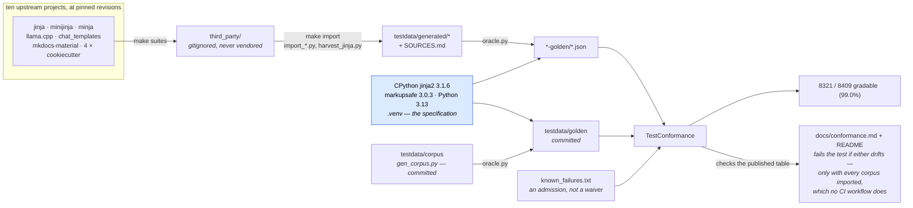
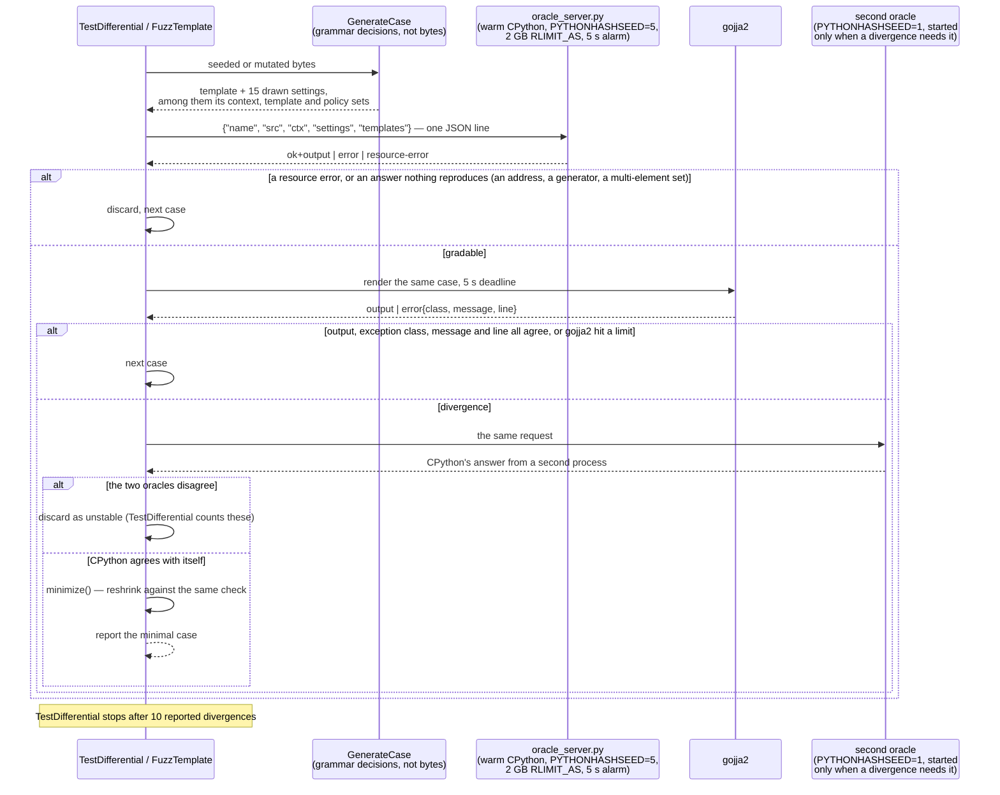

# How correct is it, and how do we know?

**8321 of 8409 gradable cases (99.0%)** match CPython jinja2, across eight
corpora from ten upstream projects. The 88 that do not are listed in
`testdata/known_failures.txt`, and a case on that list which starts passing
fails the build.

This page is the method behind that number. If you only want the number, the
README has it; if you are deciding whether to trust it, read on.

## Where the answers come from

CPython `jinja2`, pinned in `.venv`, **is** the specification. Nothing in this
repository asserts what a template *should* render; every expected output is
recorded by rendering the template with the real thing.



Only the upstreams' **inputs** cross into a corpus. Every expected output on the
right comes from the blue box, so where an upstream disagrees with CPython, the
upstream is wrong here and its own answer is discarded.

`go test ./...` on a fresh checkout runs the bottom-left path only: the first
corpus is committed with its goldens, so it grades against CPython's answers with
no network and no Python.

## The corpora

| corpus | gradable cases | matching CPython jinja2 |
|---|---|---|
| gojja2's own (committed, with goldens) | 6089 | 6005 |
| MiniJinja fixtures | 159 | 159 |
| Jinja's own test suite (harvested templates) | 658 | 656 |
| minja's syntax tests | 162 | 162 |
| llama.cpp's Jinja tests | 281 | 281 |
| LLM chat templates x 10 conversation shapes | 810 | 808 |
| A documentation theme's templates | 84 | 84 |
| Cookiecutter project templates | 166 | 166 |
| **total** | **8409** | **8321 (99.0%)** |

Each imported corpus is a different project's independent reading of the
language -- MiniJinja (Rust), minja (C++), llama.cpp's own engine, the
templates real models ship, a theme written to be used rather than tested, and
four project generators. Only their *inputs* are used: every expected output is
regenerated from the pinned CPython jinja2, because that is the specification.
On top of that, roughly a million generated templates have been rendered by both
implementations and compared (see below).

Those numbers are not typed in by hand. `TestConformance` parses this page *and*
the README's headline figure, and fails on anything that disagrees with what it
just measured -- whenever every corpus is present, since `make import` is what
builds most of them. With one absent it logs that the figures were not checked
and moves on, and no CI workflow runs `make import`, so CI never checks them: a
contributor with the corpora imported does. It does that because the table had
drifted, twice, after cases were added and the prose was not.

The 88 that differ are listed in `testdata/known_failures.txt`. A case on that
list which starts passing also fails the test, so the list can only shrink
deliberately.

Over a third of them are the same refusal in other words: CPython's message names
a line of the module jinja2 generates, or an identifier inside it -- a keyword
written twice in one call, a `break` that binds to no loop, a slice among several
subscripts, a repeated macro parameter. gojja2 refuses each of those too. Most
of the rest are Python behaviour jinja2 inherits and gojja2 deliberately does
not reproduce: object introspection
(`__subclasses__`, `__mro__`, unbound methods, generic aliases such as
`dict['k']`), the legacy iteration protocol behind `{{ self|list }}`, a folded
infinity that jinja2 writes into its generated source as the bare word `inf`,
lazy `|reverse`, `|batch` and `|slice`, a long sort's comparison order, a macro's view of the loop it was defined in, and an
`` flag that is a StrictUndefined. Two are Jinja's own
sandbox-escape tests, two are DeepSeek-R1's chat template piping `map()` into
`|tojson` (a generator, which `json.dumps` refuses), and two meet gojja2's bound
on a computed integer ([limits.md](limits.md)). [divergences.md](divergences.md)
explains most of the others by kind.

Four further cases are marked *ungradable* and left out of the table: they
render a generator's memory address, which differs between two runs of CPython
itself, so jinja2 does not match them either. Nothing else is excluded -- a case
gojja2 simply fails stays in the denominator.

Underneath, the pieces are graded separately against the real thing: CPython's
`repr()` over 3,200 floats and strings, every binary operator over a 39-value
pool (20,665 cases), jinja2's own token stream (113 cases) and its own parse
tree (100 cases).

The first corpus is committed with its goldens, so `go test ./...` grades
against CPython's answers on a fresh checkout with no network and no Python.
Run `make suites && make import` to add the rest: the upstream repositories are
cloned at pinned revisions into the gitignored `third_party/`, and the cases and
their goldens are built into the gitignored `testdata/generated/`. Nothing from
those projects is vendored or committed. The chat-templates, cookiecutter,
llamacpp, minja and wild corpora each carry a `SOURCES.md` recording where they
came from, under what license, and which inputs were dropped and why; the
minijinja and jinja-harvest importers write none, so for those two the
revision is the pin in the Makefile.

Cookiecutter templates are the one corpus that arrives with a context already
written: `cookiecutter.json` is one, in JSON, chosen by the template's author.
They contribute the shape of a template that generates a *file* -- 19 of the
166 wrap another templating language in ``, and 60 use whitespace
control -- which the chat templates and the theme between them do not reach.

The theme's templates arrive without any context at all -- a theme gets one from
MkDocs, not from a file next to it. Each context is synthesised by rendering
the template twice: once against proxies that record every access, and once
against the plain JSON that recording reads back as, requiring the two to agree
byte for byte. A template needing something JSON cannot express -- a host
filter, a callable -- is not guessed at; it is dropped, and `SOURCES.md` says
why. That dropped list is a deliverable in its own right: it is the catalogue
of what a JSON-context corpus structurally cannot reach.

`make import` also writes `testdata/generated/minijinja-divergences.md`, which
costs nothing and is worth having: MiniJinja ships a snapshot of what *it*
renders for each of its fixtures, and the CPython goldens for those same
fixtures are already recorded here. Of the 159 compared, 58 agree, 44 are
rejected by both with different wording, and 57 genuinely diverge -- MiniJinja
renders `range(3) * 3` and a case-insensitive `dictsort` where CPython raises,
among others. gojja2 matches CPython on every gradable one, which is the useful
part: those are the constructs two independent implementations read
differently, so they are where a third is most likely to be wrong.

Chat templates are not written against a bare environment -- `transformers`
gives them `trim_blocks`, `lstrip_blocks`, `loopcontrols`, a `tojson` that does
not sort keys or escape HTML, and the `raise_exception` and `strftime_now`
globals. A case records that as `"__profile__": "transformers"`, implemented
once for the oracle and once for gojja2, with `TestProfileMatchesOracle` pinning
the two together so they cannot drift apart unnoticed.

## Which CPython?

"Behaviourally identical to CPython jinja2" leaves a question open, and the
answer depends on it: identical on *which* CPython. jinja2 3.1.6 is one library,
but it runs on an interpreter, and the interpreter decides what `{{ d[0:1] }}`
raises, whether `{{ xs|sort(reverse=none) }}` is an error, how a division by
zero is worded, and which code points are digits.

Across CPython 3.11 to 3.15 that is **517 of the 6,089 committed cases**:

| | |
|---|---|
| identical on every interpreter | 5,572 (91.5%) |
| answer differently somewhere | 517 |
| of those, answering two ways | 475 |
| of those, answering three ways | 42 |

`TestPublishedVersionFigures` recomputes this table from the committed goldens
and fails on any disagreement, so it cannot go stale the way the figures it
replaced did -- those had been written for 2,241 cases and four interpreters,
and stayed while the corpus more than doubled.

None answers four or five ways. The three-way cases are where two releases
each moved the same answer: `1.0 % 0` and its neighbours, which CPython words
"float modulo" through 3.12, "float modulo by zero" in 3.13 and "division by
zero" from 3.14; the printf-style `%` errors 3.14 and then 3.15 reworded; and a
`mappingproxy` used as a key, which 3.12 and then 3.14 described differently.
gojja2 knew about two of the `1.0 % 0` wordings before the corpus reached any of
them, which is how the version that was wrong had nothing to answer for until
the cases went in.

`PYTHON_VERSION` in the Makefile pins which one is the specification, and it is
part of that specification rather than a convenience: CPython carries its own
Unicode, so the interpreter also decides the case mappings, the decimal digits
and how `repr` escapes them. It used to be whatever `uv venv` found on the
machine, which meant the specification was chosen by accident. It is **3.13**,
and `value.DefaultPythonVersion` is the same fact for a caller who does not
choose; `TestDefaultVersionMatchesThePin` fails if a bump moves one and not the
other, since gojja2 rendering as one interpreter against tables generated from
another is a wrong answer nothing else would catch.

A render reproduces the pinned version by default and any of the five on
request:

```go
env, err := gojja2.New(gojja2.WithPythonVersion(gojja2.Python311))
```

The rules are a closed list, each named in `value/pyversion.go` with the
release that moved it and the corpus case that grades it, and
`TestEveryVersionRuleNamesACorpusCase` fails a rule whose case does not exist. The version is
passed as an argument to every function whose answer can depend on it rather
than read from a package variable, so a signature carrying it declares "this
differs by interpreter", and one that does not cannot quietly start differing.

That rule has to be followed all the way out, and was not. `str()` of a
container is its repr, and a repr escapes by printability, which moves between
releases -- but `value.Str` reached `Repr`, which is the pin's. So `{{ [c] }}`
under `WithPythonVersion(3.14)` printed 3.13's answer while
`{{ c.isprintable() }}` beside it printed 3.14's. `StrFor` carries the version
the rest of the way.

### The tables are gojja2's own

CPython's Unicode and Go's are different releases, and gojja2 used to store only
the *difference* between them: `isalpha` was a correction to
`unicode.IsLetter`, `isprintable` to `unicode.IsGraphic`, and the case mappings
to `unicode.ToUpper` and its neighbours. That is smaller -- 192 ranges against
1,560 -- and it was guarded, by a sha256 over every code point that a Go upgrade
breaks loudly.

It is still the wrong shape. A difference is only true against the tables it was
measured from, so the answer a template got depended on which compiler built the
binary, and a Go upgrade rewrote two tracked files under whoever ran `make
oracle` first. The tables are now CPython's answers whole: 1,560 ranges for the
predicates, and 1,347 runs plus about 450 exceptions for the mappings, in the
shape Go's own `unicode.CaseRanges` takes. The digest stayed: it is the only
check that covers every code point rather than the ones a case happens to
mention, and it is what proves a regeneration changed nothing it should not.

Only the differences are stored. `testdata/golden` is the pinned version's full
set; `testdata/golden-3.11`, `-3.12`, `-3.14` and `-3.15` hold the cases that
answer differently -- 105, 26, 210 and 429 files, 770 in all -- laid over it. `make golden-matrix`
regenerates them by asking each interpreter through `uv run --python`, so the
sets rotate on their own when the pin moves rather than being rebuilt by hand.
`TestEveryPythonVersion` grades every case against every interpreter, and
`TestVersionOverridesAreAllUsed` fails an override that records nothing or names
a case the corpus no longer has, so the directories cannot rot as CPython moves.

**The Unicode tables move with it too.** CPython carries its own Unicode, so the
interpreter decides case mappings, which characters are digits, and how `repr`
escapes them -- 15,125 code points on which 3.11 to 3.15 do not all agree, from
Unicode 14.0.0 in 3.11 to 17.0.0 in 3.15 (measured when 3.15 was added, over
every code point's predicates, case mappings and `repr`). Those are
recorded per version as well, and the storage is small because the difference is
simply which characters had been assigned yet: they arrive in blocks, so
fifteen thousand code points collapse into ranges rather than one entry each.

Doing it turned up a bug in the pinned version rather than only in the option.
`isalpha` and `isprintable` were read straight off Go's tables, which are a
different Unicode release from the specification -- so gojja2 answered
**4,924** and **5,812** code points differently from the CPython it is graded
against, whatever version was selected. Those corrections are generated now,
against the interpreter rather than against an assumption that the two agree.

Nothing in the corpus reached any of them before, because they are all
characters assigned after Unicode 14 and no ordinary template contains one --
which is exactly why the gap survived. `testdata/corpus/unicode/` reaches them
on purpose.

## Differential fuzzing

A corpus only covers what someone thought to write down. `make soak` generates
templates from the grammar, renders each with both implementations, and
requires them to agree on everything -- output, exception class, message and
line:

```
make soak N=200000      # seeded run, reproducible
make fuzz TIME=5m       # coverage-guided, via go test -fuzz
make fuzz-props TIME=5m # properties only, no oracle -- CI runs 60 s per target
```

Generation is structured rather than byte-level: random bytes are read as
*grammar decisions*, so almost every case renders instead of being a syntax
error, and a mutation changes one choice rather than corrupting a tag. A
divergence is shrunk against the same check before it is reported, so findings
arrive minimal.

A case is an *environment* as well as a template, and **fifteen settings are
drawn alongside it**, from the same bytes as the template. Every one of them was
fixed at jinja2's default once, and each turned out to hide something.

*What the engine does with a value:* **autoescaping**, and **`select_autoescape`**
over the `html` extension, which lets each template's *name* decide -- the
case's own is `.html` and the templates it pulls in are `.txt`, so an escaping
and a non-escaping template meet across every extends, include and import --
and the **Undefined class** -- all four, `StrictUndefined` included, which was
excluded for as long as a folded constant disagreed about *when* it raises.

*What the template means:* the lexer's **`trim_blocks`**, **`lstrip_blocks`**
and **`keep_trailing_newline`**. Sixty thousand templates a run all lexed under
jinja2's defaults while the generator wrote `` constantly, and the
interaction between an explicit marker and an implicit setting is exactly where a
whitespace rule goes wrong. **`newline_sequence`** is the fourth: it had no
corpus case at all, and it changes what a string *literal is*, because jinja2
normalises the newlines it finds in the template before the parser sees them.

*What counts as a tag:* the six **delimiters**, the **line-statement prefix**
and the **line-comment prefix**, which is the lexer's whole job -- a custom set
changes what is data, where whitespace control attaches, and which of three
openings a `{` starts; the prefixes turn every tag into `# if x` on a line of its
own and every comment into `## c`. Both are applied by
rewriting the finished template rather than threading the strings through every
arm of the generator: both engines are handed the identical bytes, which is all
the comparison needs. Two details make that work -- the *auxiliary* templates are
rewritten with the delimiters, because an environment's apply to every template
it loads and an `` would not otherwise parse; and `` keeps
its braces, because jinja2 handles raw in its block scanner and `# raw` is an
unknown tag.

*What tags exist at all:* the optional **extensions**, `do` and `loopcontrols`.
The parser knows ``, `` and ``, all three need
an extension, and for as long as the run enabled none of them those statements
were graded by two hand-written corpus cases and nothing else.

*What the template reaches:* the **auxiliary templates** it can extend, include
and import (`flat`, `modules`, `chain`, `blocks`, `captured`, `escaped` and
`stateful` -- among them a module that imports another and hides a name, a
base that itself extends, and blocks inside a loop, a capture or an
``), the **context** it renders against
(`default`, `empty`, and `awkward` values), and the environment **policies**
(`urlize`'s rel and target, `truncate`'s leeway), which change what a filter
produces for every template in the environment rather than for one call. Each
is drawn from a named set, weighted toward the default the soak always used.

`GOJJA2_FUZZ_PYTHON=3.11 make soak` moves the interpreter as a sixteenth axis --
per run rather than per case -- configuring both sides to match.

Both engines are handed the same settings from one function, because there were
two built by hand and they had drifted: the syntax soak sent autoescaping and
not the Undefined class, so an axis reached one engine and not the other. **A
setting applied to one side only is a comparison between two environments rather
than between two engines, and it looks exactly like a divergence.** Every run
prints a count per axis, because a dimension that silently stopped varying would
otherwise look exactly like a clean run. For the extensions the count is of the
tag actually *written* as well as the setting drawn, and a run of more than a
thousand templates that writes none of them fails: enabling `loopcontrols` costs
a run nothing if no template ever writes a break. The same size of run fails if
it never draws `select_autoescape`, or any one of the named template, context or
policy sets.

The oracle runs as a warm subprocess. That is what makes a soak practical at
all: starting an interpreter and importing jinja2 per case costs tens of
milliseconds, which caps a cold run at a few tens of templates a second, where
keeping one up runs into the hundreds. Budget minutes for
`make soak N=200000`, not seconds -- which is why the target allows itself an
hour. The subprocess runs under a memory cap and a per-render timeout, so a
pathological case degrades to an error instead of taking the machine down.

This is where most of the subtler behaviour in this list came from: that
jinja2 wraps a sort key in a list (so two undefineds sort but do not compare),
that `` bypasses an enclosing filter buffer,
and that a name assigned anywhere at template level is invisible to nested
scopes until the assignment runs.

## The differential loop, drawn



A resource error from the oracle's sandbox — `MemoryError`, `RecursionError`,
a timeout — says the *server* ran out of room, not that the template is wrong,
so it is excluded rather than graded. jinja2 has no bounds: `{{ "x" * 2**40 }}`
allocates until something outside the process stops it, and an unguarded oracle
takes the machine with it. Both entry points run under those limits now — the
batch tool that writes goldens as much as the server, since generating goldens
is exactly when nobody is watching.

**`OverflowError` is not one of them.** `Python int too large to convert to C
ssize_t` is what CPython says about an *argument*, on any machine and every
time; it is the answer, not a symptom of how much room this process had. It
was listed as a resource error, so the fuzzer and the soak discarded every case
that raised it — while the batch tool, which classified nothing, recorded the
same exception as the expected answer and graded it. One exception was the
specification on one path and noise on the other, and the gap was where a whole
family of integer-argument divergences lived: a 36-case sweep reported 2
divergences with it listed and 23 without.

What counts as a resource error is defined once, in `tools/oracle/jinjaoracle.py`,
and both entry points import it. Writing a golden asks a narrower question —
`MemoryError` and a timeout are this machine's answer and can never be recorded,
while a `RecursionError` from a template that recurses infinitely is CPython's
and two committed goldens hold it. That is reproducible only because both paths
now pin the same recursion limit; the server used 3,000 and the batch tool
CPython's default 1,000.

## Reproducing any of this

```
make venv                 # CPython + the pinned jinja2
make suites               # clone the ten upstreams (gitignored)
make import               # build every corpus and record jinja2's answers
make conformance          # the pass rate, per corpus
make oracle-check         # do the committed goldens still match CPython?
make soak N=200000        # differential, seeded and reproducible
make fuzz TIME=5m         # differential, coverage-guided
make ask T='{{ 1/2 }}'    # ask the oracle one question
```
