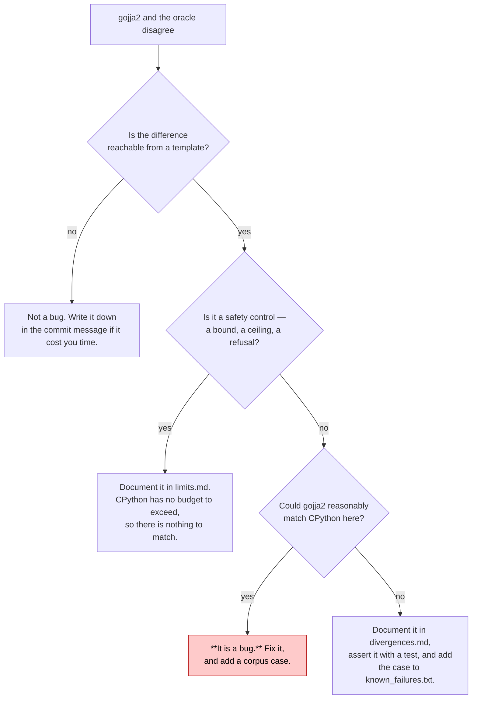
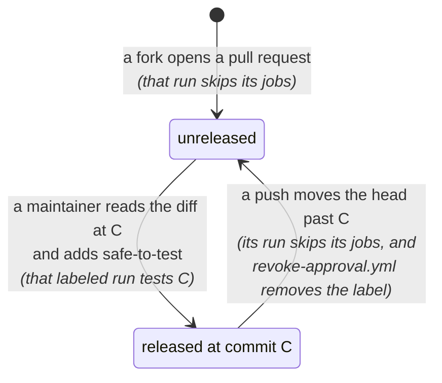

# Contributing

The short version: **CPython jinja2 is the specification, so start by asking
it.** Almost every change here begins with `make ask` and ends with a
conformance case. When a command fails, or passes having checked less than you
expected, [troubleshooting.md](troubleshooting.md) has the symptom.

## Setting up

You need Go at the version `go.mod` names — CI's `setup-go` reads the same line
— and, for anything that asks CPython, [uv](https://docs.astral.sh/uv/), which
`make venv` uses to fetch the pinned interpreter and the matrix targets use to
reach the others. `make lint` runs whichever `golangci-lint` is on your `PATH`;
CI pins its version in the `lint` job of `.github/workflows/ci.yml`, so install
that one to see what CI sees. The memory caps used throughout this page are
`systemd-run --user`, which needs a user systemd instance.

```
make venv       # CPython + the pinned jinja2, into .venv
make test       # grades the committed corpus; needs neither network nor Python
make suites     # clone the ten upstreams (gitignored, a few minutes)
make import     # build the other seven corpora and record jinja2's answers
```

`make test` works on a fresh checkout because the first corpus ships with its
goldens. Everything else is optional until you want the full pass rate.

## The gate before every commit

```
make check
```

That is `fmt-check vet test memlimit race lint`, the Linux job's steps in CI's
order. It is not everything CI runs: the same job then fuzzes `FuzzParse`,
`FuzzRender`, `FuzzAutoescape` and `FuzzRenderData` for 60 s each — `make
fuzz-props TIME=60s` is the same four commands — and Windows and macOS jobs run
vet, test and race on triggers of their own (see [Sending it](#sending-it)). If
`make check` passes and the matching CI step does not, that is a bug in the
Makefile and worth reporting on its own.

**Run it under a cgroup cap.** This suite deliberately renders hostile templates
— `{{ range(10000000000)|list }}`, `{{ "x" * 1000000000 }}` — and a bound that
is not yet in place means an allocation that does not stop:

```
systemd-run --user --scope -p MemoryMax=8G -p MemorySwapMax=0 -p CPUQuota=400% make check
```

Without the cap, a missing guard takes the machine instead of the process. With
it, the same bug is an exit code you can read, which is also the clean way to
*demonstrate* that a safety bound fires.

When you are reproducing a resource bug, put the probe in a throwaway module
outside this repository rather than in a `zz_test.go` here. A probe dropped in
the tree joins the package, so `go test ./...` gets killed too and the whole run
reports `Terminated` with no usable signal.

## I think I found a bug

Ask the oracle first. It is one command, and about a third of the time the
answer is that jinja2 does the same thing:

```
make ask T='{{ [1,2]|map("string")|last }}'
make ask T='{{ a + 1 }}' C='{"a": 41}'
```

Then decide which of three things you have:



The default answer is the red one. `divergences.md` says so at the top —
"anything not listed here is a bug" — and the list is deliberately short. A new
entry needs a reason that would survive someone asking "why not just match it?",
and the reasons that have survived are: CPython's answer is unreachable from a
template, unreproducible between two runs of CPython itself, or a safety
control.

### Listing a case in `known_failures.txt`

`testdata/known_failures.txt` has one row per case; blank lines and lines
starting with `#` are comments. A row is an id, an optional version, and a
reason:

```
own/divergence/some_case.jj2              # why gojja2 differs
own/divergence/other_case.jj2@3.14        # agrees with the pin, differs on 3.14
minijinja/opfilters_txt.jj2               ungradable: why nothing can match it
```

- **The id** is the corpus name, a slash, and the case's path under that
  corpus: `own/` for the committed corpus in `testdata/corpus`, otherwise the
  name `TestConformance` gives the imported corpus — `minijinja`,
  `jinja-harvest`, `minja`, `llamacpp`, `cookiecutter`, `wild` or
  `chat-templates`.
- **The reason** follows a `#`, or follows the id after a space. One that
  starts `ungradable:` takes the case out of the rate altogether, so keep it
  for a case CPython itself cannot reproduce.
- **`@<version>`** limits the row to that interpreter in
  `TestEveryPythonVersion`. A row without one applies to every interpreter, and
  it is the only kind `TestConformance` reads.

`TestConformance` fails on a listed case that passes, on a row naming a case its
corpus does not have (checked only when that corpus is present), and on a case
listed twice.

## Adding a conformance case

**Cases go in `tools/oracle/gen_corpus.py`, never as a loose `.jj2` file.**
`main()` starts with `shutil.rmtree(testdata/corpus)` and rewrites the whole
directory from the `CASES` list, so a hand-added file is deleted by the next
`make oracle` — reported only as a bland change in the case count. Nineteen were
lost that way once. The script's own comment marks where they were recovered
to.

```python
case("filters/attr_name_not_a_string", '{{ "ab"|attr(name=true) }}')
case("errshape/dyn_kwargs_names_the_filter", '{{ lst|join(**5) }}', lst=[1, 2])
```

The first argument is the path under `testdata/corpus`, the second the template,
and any keywords become the render context — except three, which configure the
case instead and are stripped from the context before it renders:

| keyword | what it is |
|---|---|
| `__settings__` | environment options, e.g. `{"extensions": ["do"]}`; a key not in `SETTING_KEYS` (`tools/oracle/jinjaoracle.py`) is refused |
| `__templates__` | `{name: source}` of further templates the case can include, import or extend |
| `__profile__` | a named environment profile from `tools/oracle/profiles.py`, such as `"transformers"` |

Then:

```
systemd-run --user --scope -p MemoryMax=4G -p MemorySwapMax=0 make oracle
```

which regenerates the corpus *and* re-records every golden from CPython. Check
the diff: a golden that changed for a case you did not touch means something
else moved, and that is the interesting part.

`make oracle` also regenerates ten files from CPython itself — `arity.go`,
`method_arity.go`, `method_arity_other.go`, `entities.go`, `strclass.go`,
`casemap.go`, `utf8digest.go`, `value/decimaltable.go`,
`value/unicode_other.go` and `value/nameclass.go`. Do not hand-edit those;
change the generator.

**Which CPython generates them is pinned**, by `PYTHON_VERSION` in the Makefile
— 3.13 — and `make venv` asserts it, as does `TestDefaultVersionMatchesThePin`
against `value.DefaultPythonVersion` and the header of every generated file. That is part of the specification rather than a
convenience: CPython carries its own Unicode, so the interpreter decides the
case mappings, the decimal digits and how `repr` escapes them. It used to be
whatever `uv venv` found on the machine, which meant the specification was
chosen by accident and two contributors could regenerate different goldens.

The Unicode tables are the ones with a history worth knowing. Several of them
recorded *only where CPython differs from Go's own tables*, which is sound only
while the two agree about everything else — and nobody checked that. They do not
agree, and how far apart they are depends on the pin: Go 1.26 was Unicode
15.0.0 when this was measured (Go 1.27, the pin now, is 17.0.0), CPython 3.13
is 15.1.0 and 3.14 is 16.0.0. On the 3.14 pin that
assumption silently produced the wrong answer for 54 case mappings, 4,924
`isalpha` code points and 5,812 `isprintable` ones before the checks below
existed; on 3.13 the same gap is 622 and 627, which is smaller and just as
wrong. The case mappings and the predicates are now CPython's answers whole
rather than differences from Go's (see
[conformance.md](conformance.md#the-tables-are-gojja2s-own)), so they no longer
depend on which Go built the binary; `tools/gocase`, which dumps Go's tables
for that comparison, is no longer run by any generator.

Three tripwires guard the result, and each recomputes over every code point so a
drift shows up as a test failure rather than as one wrong character:

| test | covers | regenerate with |
|---|---|---|
| `TestCaseMappingMatchesCPython` | upper, lower, title, casefold and the three case predicates | `make casemap` |
| `TestDecimalValuesMatchCPython` | which characters `int()` and `float()` read as digits | `make decimal` |
| `TestUTF8DecodeMatchesCPython` | every way the UTF-8 decoder can refuse a byte | `make utf8` |

If one fails after a toolchain upgrade or a `PYTHON_VERSION` bump, regenerate
and read the diff: it is telling you either that Unicode moved or that the
pinned CPython did.

## How the suite checks itself

Grading against CPython answers "does gojja2 agree?". Four more tools ask
whether the grading itself can be trusted, and each has a make target:

- `make syntax` records jinja2's own parse tree in gojja2's vocabulary, and
  `TestSyntaxMatchesTheReference` requires the two to encode byte for byte --
  the evidence behind the tree `Template.Syntax` exposes.
- `make mutate` removes, one at a time, each place the analysis records
  something and each place the budget charges, and reports any whose removal no
  test notices.
- `make ungraded` counts the error messages no corpus case has ever produced,
  which therefore have never been compared with CPython.
- `make soak-syntax` asks the structure and the analyses of templates nobody
  chose, and then asks the engine whether the answers are true.

[verification.md](verification.md) says what each one proves, how it was
built, and what it has found.

## What watches the oracle

CI never runs Python: the whole point of committing the goldens is that the
suite grades them with no network and no interpreter. That leaves the
generators, the differential checks and CPython's own releases unwatched, so a
separate workflow, `.github/workflows/oracle.yml`, runs them. It never runs on
a push: it runs every Monday at 04:23 UTC, on the first of each month at 05:41
UTC, and on demand from the Actions tab. It has three jobs.

**`regenerate`, on every run: regenerate everything and compare.** `make
oracle`, then the four recorded corpora it does not cover (`make ops-corpus
repr-corpus lex-corpus parse-corpus`), then `git add -A && git diff --cached` —
so a new or deleted file counts as drift too. A difference means one of three
things and the diff says which: a generator broke, CPython changed its mind, or
somebody edited a generated file by hand. This exists because `make casemap`
was broken for three commits by a change to the tool it reads, and nothing could
tell: the committed table still agreed with the interpreter, so every test
passed. `make value-depth` (`testdata/value_depth.json`) is in neither `make
oracle` nor this job, so nothing regenerates it on a schedule; run it by hand
when an interpreter changes.

**`differential`, on every run: generated templates, both ways.** `make soak
N=50000` and `make soak-syntax N=20000`, both seeded with the run's id, which
the job summary records so a failure replays with `make soak N=50000
SEED=<id>`; then `make fuzz TIME=5m`, from the runner's cold cache. On the
monthly run and a manual one it also runs `make mutate ARGS=--budget`, the
budget half of [mutation testing](verification.md#and-the-budget-for-the-same-reason). The
runner has no user systemd for the per-mutation cap, so `MUTATE_CAP` names one
instead; the analysis half needs the imported corpora, which no workflow
builds.

**`releases`: has CPython moved?** `tools/oracle/scan_pythons.py` compares the
releases uv can provide against `pyversions.ALL`, and reports a release that
*disappears* too, since every matrix target reaches its interpreters through
`uv run --python`. The Monday run only lists what is new or gone. The monthly
run, and a manual one unless its `releases` input is unticked, add `--grade`,
which does the reading a maintainer would otherwise do by hand — renders the
whole corpus under each new interpreter, asks it about every code point, counts
the method wordings that differ — so a new release arrives as a diff rather
than as a note to look into some time.

A job that finds something to do fails, which is the notification; the
regenerate and releases jobs write their report to the job summary. Locally,
`.venv/bin/python tools/oracle/scan_pythons.py --grade` is the releases scan.

The differential harness talks to a live interpreter rather than to the
goldens, and `GOJJA2_ORACLE_PYTHON` points it at one: useful for a checkout
whose virtualenv lives elsewhere, and -- aimed at a path that does not exist --
for proving the suite really does grade the committed corpus with no Python.
Whatever it names is checked on startup against the interpreter and libraries
the goldens record, because an oracle on another CPython is a different
specification and a differential run against one reports every version
difference as a gojja2 bug.

Three matrix targets regenerate everything that is stored per version, each by
asking every interpreter through `uv run --python`, so none of them needs a
hand-built environment: `make unicode-matrix` for the Unicode tables,
`make arity-matrix` for the built-in method wordings, and `make golden-matrix`
for `testdata/golden-<version>`. All three are part of `make oracle`, which
means a `PYTHON_VERSION` bump rotates which version needs no overrides without
anyone editing a list. `TestEveryPythonVersion` grades the whole corpus
against each one.

If your case changes the corpus count, `TestConformance` will tell you the exact
table row it wants — on a machine with every corpus imported (`make suites &&
make import`). With any imported corpus absent it logs "published figures not
checked" and checks none of them, and no CI workflow imports the corpora, so a
green CI run says nothing about these figures. Paste the row into
`docs/conformance.md`; the README's headline sentence, the diagram's rate node
and the count of cases that differ are checked too, and the test prints what it
expected for each.

## Changing an existing golden

Don't, directly. `testdata/golden/*.json` is what CPython produced; if it needs
to change, either the case changed or the pinned jinja2 did. `make oracle-check`
re-renders the committed corpus and verifies `testdata/golden` still matches,
without rewriting it, which is the one to reach for when you want to know
whether something moved underneath you. It checks the pinned version's goldens
only: `testdata/golden-<version>` and every other generated file are checked
by regenerating them with `make oracle` and diffing the tree, which is what the
`regenerate` job does.

Bumping `JINJA_VERSION` means regenerating every corpus wholesale, never
piecemeal — the goldens are one version's answers, and a mixture is not a
specification.

## Writing a filter, test, global or object

[extending.md](extending.md), which has the contract and runnable examples. The
short version: charge a template-chosen size *before* you allocate it, and call
`State.Poll` in any loop that does sustained work without writing output.

## Hunting for divergences

`make soak N=200000 SEED=7` generates templates from the grammar and requires both
implementations to agree on output, exception class, message and line.
`make fuzz TIME=5m` does the same, coverage-guided. Both need `make venv`.

`SEED=` fixes the generator's seed, so a soak that found something can be
replayed exactly; it defaults to 0, which means every run without it explores
the same templates. Change it when you want new ground rather than a repeat.

`make fuzz-props TIME=5m` needs nothing but Go, and CI runs its four targets
for 60 s each on every commit. It cannot
say what a template *means* -- only CPython can say that -- so it checks what
the engine owes every input regardless of meaning: it does not panic, it does
not run past its deadline, it does not write past its bound, it does not return
an error with no Kind on it, and -- under autoescape -- it does not let a plain
string's markup reach the output as written. That is a weaker question asked far more
often, and it has found what the differential fuzzer structurally cannot: a
constant expression that hung `FromString`, where there is no render, no
context and nothing for CPython to disagree with.

Two things to know before you trust a result:

- A divergence whose CPython side is `MemoryError`, `RecursionError` or a
  timeout is the oracle's own sandbox refusing, not a finding.
- A CPython side containing `object at 0x...` is a repr with an address in it,
  and is ungradable for the same reason `lipsum()` is.

### Knobs and exit codes

The make targets set these for you; a bare `go test` reads them too, but where
one is unset each test falls back to its *own* default, which is not the make
target's. `go test ./conformance -run TestDifferential` checks 3,000 templates
at seed 20260916, where `make soak` checks 50,000 at seed 0.

| variable | what it sets |
|---|---|
| `GOJJA2_FUZZ_N`, `GOJJA2_FUZZ_SEED` | the count and seed of every seeded generated-template test in `conformance/`: the differential, the syntax soak and the metamorphic properties (`GOJJA2_FUZZ_SEED` also seeds the lazy-conversion test) |
| `GOJJA2_LAZY_N` | the count for `TestLazyConversionMatchesEager`, which compares lazy and eager conversion of a Go context and needs no oracle (default 2,000) |
| `GOJJA2_FUZZ_PYTHON` | which CPython the differential asks, e.g. `3.11`, configuring gojja2 to match; unset is the pin |
| `GOJJA2_ORACLE_PYTHON` | the interpreter the oracle runs under, in place of `.venv/bin/python` (see [What watches the oracle](#what-watches-the-oracle)) |
| `MUTATE_CAP` | the command prefix `make mutate` runs each measuring step under, in place of its own `systemd-run` cap |

| tool | exits non-zero when |
|---|---|
| `make ungraded` | only when the corpus fails or the tool cannot run: it reports a count and is not a gate |
| `make mutate` | a mutation survives (1), or it refuses to start: a check fails unmutated, or the analysis half finds no imported corpora |
| `make oracle-check` | a golden is stale or missing (1) |
| `tools/oracle/scan_pythons.py` | there is something to do (1): a release gojja2 does not know, or one uv can no longer provide |

## Documentation

Docs are graded like code, by five checks. `go test ./...` runs four guards
over them:

| guard | requires |
|---|---|
| `TestDocLinksResolve` | every relative link resolves, and every `#anchor` names a real heading |
| `TestNoDocIsOrphaned` | every `.md` is reachable by a link from another one |
| `TestNoGodocLinkSyntaxInMarkdown` | no `[Identifier]`, which is godoc syntax and renders as literal brackets |
| `TestExtendingDocExamplesAreReal` | every definition shown in `extending.md` exists verbatim in `example_test.go` |

The fifth is `checkPublishedNumbers`, inside `TestConformance`: it checks every
published conformance figure against what it just measured, but only on a
machine with every corpus imported, so CI never runs it (see
[above](#what-watches-the-oracle)). [docs/README.md](README.md) names a canonical home for each fact worth
stating once; if you find yourself writing something down for the second time,
link instead.

## Sending it

CI (`.github/workflows/ci.yml`) starts on a pull request when it is opened,
pushed to, reopened or labelled, on every push to `main`, nightly at 05:17 UTC,
weekly on Sunday at 06:41 UTC, and on demand. Which jobs run depends on the
trigger:

| job | steps | pull request | push to `main` | nightly | weekly | on demand |
|---|---|---|---|---|---|---|
| `check` (Linux) | fmt · vet · test · GOMEMLIMIT · race · fuzz, 4 targets × 60 s | yes | yes | yes | — | yes |
| `lint` | golangci-lint, at the version the job pins | yes | yes | yes | — | yes |
| `windows` | vet · test · race | without race | yes | — | yes | yes |
| `macos` | vet · test · race | — | — | — | yes | yes |

Every job waits on `authorize`. It trusts a run that is not a `pull_request`
event, and a pull request whose branch is in this repository -- except on a
`labeled` event, which such a pull request does not need. A **fork's** pull
request is trusted on exactly one event: a maintainer *adding* the
`safe-to-test` label. Its open, push and reopen runs skip every job whatever
labels it carries. CI executes the code in the pull request, which is why a
fork's runs nothing until somebody with write access has decided to run it.



- **The label is the trigger, not a standing permission.** Adding it raises a
  `labeled` run, and that run tests the commit the pull request had at that
  moment. A push afterwards runs nothing until the label is added again, so the
  approval always names a commit someone chose to release.
- **Read the head before labelling.** The labelled run tests whatever is at the
  head when the label lands, so a commit pushed between your review and the
  label is the one that runs. No label scheme closes that window; checking the
  head commit hash before labelling does.
- **The label is removed on a push** by `revoke-approval.yml`
  (`pull_request_target`, `synchronize`), so the pull request does not look
  released when its new head is not. That workflow never checks out the pull
  request's code. Removing it is bookkeeping: CI does not read it from a push.
- **Another label runs nothing.** A `labeled` run for any other label, or on a
  pull request from this repository, skips every job, and has a concurrency
  group of its own so it cannot cancel a run that is doing something.

Commit messages here say *why*, at length, and name what was checked. Look at
`git log` before writing one.
