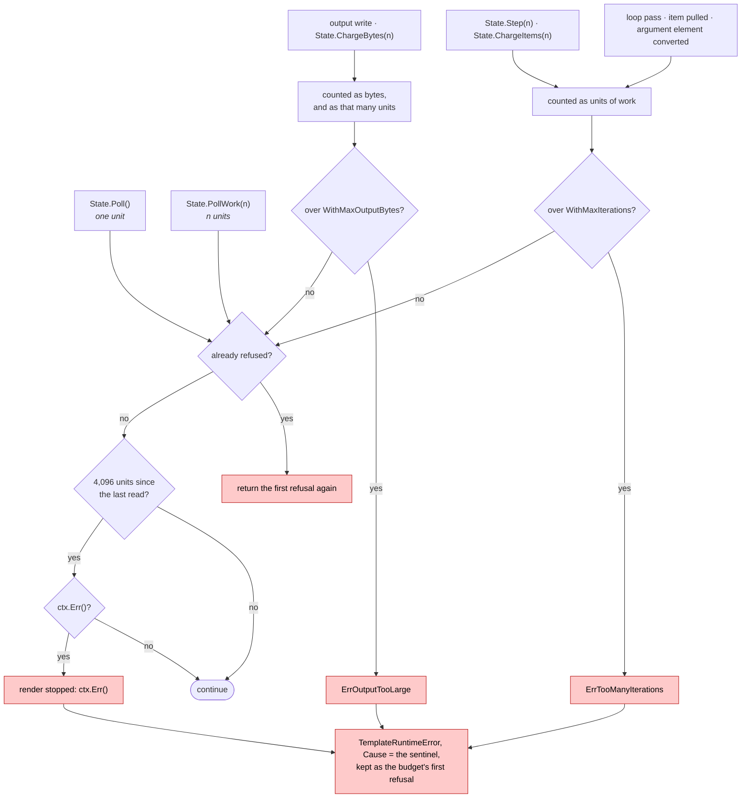

# What bounds a render

CPython jinja2 bounds nothing. It expects the caller to be running templates it
wrote itself, so `` spends hours and
`{{ range(10000000000)|list }}` allocates until the OOM killer arrives. gojja2
renders templates whose author its caller may not be, so it bounds them.

**If you read one thing here, read this:** give every render a
`context.Context` with a deadline. That is the precise tool, and it is the one
that matches what you actually care about. Everything else on this page is a
backstop for a caller who passed `context.Background()`.

These are safety controls, not behavioural choices. That is why their errors
have no CPython counterpart, and why they live here rather than in
[divergences.md](divergences.md): CPython has no budget to exceed, so there is
nothing to match. What *is* a divergence is the existence of the bound, and
that is what this page records.

## The bounds

| what | default | how to change it | a negative value | what you get |
|---|---|---|---|---|
| wall clock, cancellation | none | the `context.Context` every render takes | — | `TemplateRuntimeError` wrapping `ctx.Err()`, noticed within 4,096 units of work ([below](#how-promptly-a-cancelled-render-stops)) |
| units of work: loop passes, items pulled from a sequence, elements of a render argument converted from Go | 10,000,000 | `WithMaxIterations` | removes it | `TemplateRuntimeError` wrapping `ErrTooManyIterations` |
| output bytes | 256 MiB | `WithMaxOutputBytes` | removes it | `TemplateRuntimeError` wrapping `ErrOutputTooLarge` |
| include/extends/import/macro/block nesting, and a recursive `` | 100 | `WithMaxRecursion` | **the default**, 100 | `RecursionError`, the limit on its `Limit` field |
| parse-tree nesting | 1,000 | fixed | — | `TemplateSyntaxError` |
| width of a computed integer | 2**20 bits | `WithMaxIntBits` | removes it | `OverflowError` |
| size of one repetition | 2**31−1 elements | fixed | — | `OverflowError` |
| any template-chosen allocation | 2**31−1 bytes or elements | fixed | — | `OverflowError` |
| one constant fold, at compile time | 100,000 units of work, 64 KiB of output, a 64 KiB result | fixed | — | no error; the fold is declined and the work moves to render time, where the budget applies ([below](#a-budget-on-constant-folding)) |

**Zero means *the default*, not "off", for every configurable bound.** A
negative value removes the iteration, output and integer-width bounds, and
`WithoutLimits()` removes the iteration and output budgets together. Recursion
cannot be removed: `WithMaxRecursion` with a negative value is the default,
because past it is a Go stack overflow, which kills the process. That way a
configuration nobody filled in -- a struct deserialised from YAML or flags -- is
the bounded one. Options apply in the order they are given, so a later one
wins: `WithoutLimits(), WithMaxIterations(0)` has the default iteration bound
and no output bound.

All three budget refusals -- iterations, output, context -- are an
`*errs.Error` of class `errs.TemplateRuntimeError`, with the sentinel
(`ErrTooManyIterations`, `ErrOutputTooLarge`, or `ctx.Err()`) as its `Cause`,
so `errors.Is` finds it. **The first refusal sticks:** the budget keeps it, and
every charge after it returns the same error, so a render that has been refused
once cannot succeed -- even if the code that was refused dropped the error --
and the error the render returns is that first refusal, not whatever the
template tripped over next.

`WithoutLimits()` does **not** remove the integer-width ceiling, and does not
remove the 2**31 caps either. Those are ceilings rather than budgets: a budget
is what the caller asked to spend, a ceiling is what the process survives when
they asked for nothing. Removing the integer ceiling is asked for by name,
because it is the one that stops an expression growing exponentially from a
template of fixed size.

The iteration and output budgets are carried on the render's `*State` and shared
across ``, `` and ``, so a nested render
cannot start a fresh allowance.

If you are writing a filter, a test or a global of your own, the budget is your
responsibility too: charge a template-chosen size with `State.ChargeBytes` or
`State.ChargeItems` *before* you allocate it, and call `State.Poll` once per
unit of any sustained work that neither charges nor writes output. [extending.md](extending.md)
has the contract in full, with runnable examples.

---

## Limits on allocation

### A width limit on computed integers

```jinja
{{ 2 ** 100000000 }}


```

CPython will try to materialise both. gojja2 refuses with `OverflowError` once a
computed integer would exceed 2**20 bits (128 KiB, about 315,653 decimal
digits), because a magnitude in a template is frequently attacker-influenced and
the honest answer is a denial-of-service. Integers below that limit are exact
and unbounded by machine word size, so `{{ 2 ** 100 }}` still renders all 31
digits.

The width is checked *before* the integer is computed, so it is estimated from
the operands, and the estimate is an upper bound: for `**` it is the width of
the base times the exponent, which for a small base is up to twice the real
width. A result under the limit can therefore be refused --
`{{ 2 ** 600000 }}` is 600,001 bits wide, is estimated at 1,200,000, and is
refused against the default 1,048,576.

**The limit is on integers, not on one operator.** It was on `**` alone to begin
with, which made it decorative: `x ** 2` was refused past the width and `x * x`
-- the same number, one character shorter -- was not. That mattered more than a
missing special case, because multiplication *doubles* the operand width, so the
second template above grows exponentially while staying the same size. Twelve
iterations and four bytes of output were enough to exhaust the machine with
`WithMaxIterations` and `WithMaxOutputBytes` both set, since neither of those
counts the memory a `big.Int` occupies.

Every operation that can widen an integer -- `+`, `-`, `*`, `**` -- asks the same
question before it allocates, so an operator added later inherits the bound
instead of reopening the hole.

**This is the one bound that is also a conformance question**, which is why it
is the one with a knob. CPython computes `(2**500000) * (2**500000)`; gojja2
refuses it by default. `WithMaxIntBits` raises the ceiling, and a negative value
removes it and gives CPython's arithmetic back.

Removing it is not free, and the cost is worth stating: the only backstop left
is the 2**31-byte ceiling on a single allocation, and a 2 GiB integer is enough
to exhaust most processes on its own — a squaring loop reaches it in about forty
iterations. The width is charged against the output budget *before* it is
allocated, though, so keeping a `WithMaxOutputBytes` bounds such a loop even
with the ceiling gone. That combination — the ceiling removed, a budget kept —
is how to have CPython's answers without giving up the floor, and it is the only
configuration in which an expression can still exhaust the process that does not
say so twice.

The width is also charged against the output budget, like any other allocation a
template sizes for itself. A render that computes a 128 KiB integer has
committed 128 KiB whether or not it ever prints it, so a tight
`WithMaxOutputBytes` refuses it earlier than the hard ceiling does.

### A length limit on repetition

```jinja
{{ "x" * 2147483648 }}
```

Repeating a string or a sequence is refused once the result would exceed
2**31 elements, for the same reason: the count is often attacker-influenced.
CPython would attempt the allocation.

That cap is on a single result. A repetition just under it is still gigabytes,
so the render's budget is charged for what a repetition is about to allocate
*before* it allocates -- bytes against the output budget, elements against the
iteration budget. Charging it afterwards would be charging for memory that is
already gone.

### A budget on constant folding

```jinja
{{ "x" * 1000000000 }}
{{ "x" * 60000 + "x" * 60000 }}
```

Both are constant, so jinja2's optimizer and gojja2's evaluate them at compile
time. There is no render at compile time, and so none of the render's budget to
charge, which made `env.FromString` on the first of these allocate a gigabyte
before anything had asked for a render; the second doubles for every level a
template nests it.

So folding has a budget of its own, whatever the environment's limits:
100,000 units of work and 64 KiB of output, spent per fold *attempt* -- reset
for each expression, because whether an expression folds is observable and must
not depend on what precedes it in the file -- plus the environment's
integer-width ceiling. A result is kept only if it is at most 64 KiB: bytes for
a string, *elements* for a list or tuple. A fold that runs out of either, or
that raises, is declined without an error, leaving the expression to be
evaluated at render time where the render's budget bounds it. The rendered
result is identical -- it is just not computed early. Ordinary constants still
fold, and nothing written on purpose builds a 64 KiB one this way.

A filter or test the host registered is folded too, when every operand is a
constant, and runs under this budget: see
[extending.md](extending.md#5-you-may-be-run-at-compile-time).

A folded constant is part of the compiled template, so it is not charged again
when a render uses it. A list or dict in it is copied for each evaluation, so no
render can change it for the next, and the copy is not charged either: it was
bounded when it was folded. So `{{ ("x" * 60000)|length }}` renders under
`WithMaxOutputBytes(1000)`, where the same string built from a variable is
refused.

### A charge before every sized allocation

Anything a template sizes from a number it chose -- a pad width, an indent, a
rounding precision, a slice or batch count, `lipsum`'s paragraph count, the
result of a `replace` -- is charged against the render budget *before* it is
allocated, and refused outright past a hard ceiling of 2**31 bytes or elements.

So is anything it sizes from a value it was *handed*: `~`, `+` and `*` all
build a result as large as their operands, and all are charged for it whether
or not the result is ever written -- bytes against the output bound for a
string, elements against the iteration bound for a list or tuple. `` over an eight-megabyte argument is refused by a kilobyte output bound,
the same as `` and `` are. A chain of
string `+` is charged once, for the one string it builds.

So is the copy a render makes of anything that reached it from outside -- an
environment global, a `value.Value` in its context, what a host function,
filter or method returned -- before a template can change it: elements against
the iteration bound, as a list built in the template would be. A dict global is
copied, and charged, only as far as the render reaches into it.

The ceiling exists because a caller can remove the budgets -- `WithoutLimits()`,
or a negative `WithMaxIterations` or `WithMaxOutputBytes` -- and unbounded must
still not mean "allocate 2**63 bytes". It is the same ceiling
`value.repeat` has always applied to `*`, so both halves of the engine refuse
the same sizes.

Where CPython raises `MemoryError` for these, gojja2 raises its own
`OverflowError` or fails the render with `ErrOutputTooLarge` /
`ErrTooManyIterations`, depending on which bound was reached. CPython has no
budget to exceed, so there is nothing to match here; the divergence is the
bound itself, which this file already records above.

One narrow band of that is *not* a `MemoryError` and so is a real difference in
wording: a `bytes` whose requested size is within `sizeof(PyBytesObject)` of
`PY_SSIZE_T_MAX` fails CPython's structural check rather than its allocator, so
`{{ 'abc'.encode().center(9223372036854775807) }}` and
`{{ (3).to_bytes(9223372036854775807, 'big') }}` are
`OverflowError: byte string is too large`, while one byte smaller than the band
-- measured at `2**63 - 33` on the pinned interpreter -- is a `MemoryError`
again. gojja2 answers its own byte bound throughout. Reproducing the band means
hard-coding the size of a CPython struct, which changes with the build, and every
value below it is unrecordable anyway; the wording is recorded here instead.

Not all of them reach a `MemoryError` at all. `{{ x|slice(10000000000000000000000) }}`
is a perfectly legal `range()` in CPython, which then walks it, so the template
does not fail -- it runs until something outside the process stops it. gojja2
saturates the count and charges it, so the same template is an `OverflowError`
in bounded time. The count is charged rather than clamped: clamping a refusal
into "allocate the maximum" is the failure this ceiling exists to prevent.

### A backstop on panics

A panic anywhere inside gojja2 is turned into a render error wrapping
`ErrInternal`, at both entry points: `FromString`/`GetTemplate` and
`Render`/`RenderString`.

This is a backstop, not a licence. A template engine renders input its caller
does not control, so unwinding the caller's goroutine is never the right answer
to a bad template -- the render failed, so the render should say so. Every panic
that reaches it is a bug here rather than in the template, and the error says
so and carries the panic value, so a report can name it.

Constant folding recovers separately and more quietly: an optimisation must
never fail worse than not optimising, so a fold that panics simply does not
happen and the expression is left for runtime, where the render's budget
applies to it.

## A bound on nesting depth

```jinja
{{ [[[[[ ... 100000 levels ... ]]]]] }}
```

CPython raises `RecursionError` at around a thousand frames. Go grows a
goroutine's stack on demand, so gojja2 would parse a million levels happily and
then die on an allocation it cannot recover from.

gojja2 refuses past 1,000 levels of expression or statement nesting with a
`TemplateSyntaxError`. Templates are frequently attacker-supplied and nothing
written on purpose nests ten deep, let alone a thousand, so the limit is
generous and the failure is clean. It is a safety control rather than a
behavioural choice, which is why the exception class differs from CPython's.

What is counted is the depth of the parsed *tree*, one level per node on a
root-to-leaf path, and not how deeply the parser happened to recurse. That
matters because a template can nest without any bracket at all:

```jinja
{{ not not not ... }}      {{ ------- ... 1 }}      {{ x|f|f|f|f ... }}
```

Each of those is built by a loop, and each produces a tree as deep as it is
long -- which the constant folder, the frame-local visitor, the dependency
checker and the evaluator all then descend once per level. `~` and a
comparison chain are the exception in the other direction: like jinja2's own
`Concat` and `Compare` they are one node over a flat list of operands, so
`a ~ b ~ c ~ ...` is one level however long it runs.

Runtime recursion -- a template that includes, extends, imports or calls
itself without a base case, a block that renders itself, a recursive
`` over data that does not end -- is bounded separately at 100 levels,
controlled by `WithMaxRecursion`, and *does* raise `RecursionError` with
CPython's wording for the interpreter `WithPythonVersion` selects. The
configured limit is on the error's `Limit` field rather than in the message.

**From 3.12 on there is one wording**, and every one of those routes reports
it: `maximum recursion depth exceeded`. That includes the default interpreter,
3.13. The value walks in [the next section](#how-deep-a-value-may-be-before-printing-it-fails)
keep their own suffixes on every version.

**Before 3.12** -- `WithPythonVersion(Python311)` -- CPython had three
wordings, and for most constructs which one you got was not a property of the
template. It records where *CPython's own* stack ran out, so the identical
recursion reports different messages depending only on how many frames the
caller was already using:

```python
# the same template, rendered from N frames deep
N=0   maximum recursion depth exceeded
N=1   maximum recursion depth exceeded while calling a Python object
N=2   maximum recursion depth exceeded
```

A macro calling itself, a recursive loop, a block reference and ``
all move like that. Only two were stable at every depth tried:

| construct | message |
|---|---|
| `` | `maximum recursion depth exceeded while calling a Python object` |
| an `` cycle | `maximum recursion depth exceeded in comparison` |

Under 3.11 gojja2 reports CPython's wording for those two, and `while calling
a Python object` for everything else. That last choice is arbitrary, and
deliberately so: any
wording picked for the unstable constructs encodes the stack depth of whichever
harness recorded it. Two of the imported MiniJinja fixtures were captured with
`while calling a Python object` for exactly that reason, and a plain
`maximum recursion depth exceeded` -- which is what a shallow stack gives --
would make them fail. There is no answer here that is right in both harnesses,
so nothing is gained by changing it.

Under 3.11, autoescaping and `loop.previtem` move the wording too: the first
because markupsafe's escape is a C function, the second because reaching the
previous item compares against a sentinel. Neither is a thing a Go program
does, and neither changes what the template did wrong. The error kind is
`RecursionError` throughout, on every version, and the configured limit is on
the error's `Limit` field.

## How deep a value may be before printing it fails

```jinja


{{ ns.t }}
```

The depth of a *value* is chosen at render time, not at compile time -- the
nesting bound above is about the template's own text, and says nothing about
what a loop builds. CPython walks such a value with its interpreter stack and
raises `RecursionError` when it runs out, with a different message for each
walk: `while getting the repr of an object`, `in comparison`, `while encoding a
JSON object`.

Where CPython runs out is not one number. It was ~990 for every C-level walk
until 3.12 gave the C recursion limit a counter of its own, and from 3.14 grows the
stack rather than counting frames at all; `pprint` did not move, because it
recurses in Python and three frames a level reaches the *Python* limit first.
Each number below is the deepest value that walk survives, measured per
interpreter by `make value-depth` into `testdata/value_depth.json`, and
`TestValueWalkDepthsAreMeasured` fails if this table drifts from it or from
gojja2's own wall:

| walk | 3.11 | 3.12 | 3.13 (pinned) | 3.14 | 3.15 | gojja2 |
|---|---|---|---|---|---|---|
| `==`, `<`, `\|min` | 992 | 9994 | 9995 | 43430 | 40114 | 1000 |
| `\|sort` | 990 | 9993 | 9993 | 43405 | 40089 | 999 |
| `\|tojson` | 986 | 9993 | 9994 | 52115 | 47405 | 1000 |
| `\|pprint` | 326 | 328 | 328 | 328 | 328 | 1000 |
| `{{ v }}`, `\|string`, `\|upper`, a dict key | 990 | 9993 | 9994 | 65145 | 65185 | no wall |
| hashing a tuple | no limit | no limit | no limit | no limit | no limit | no limit |

The `|sort` row is one lower than the comparison row on both sides for the same
reason: the list being sorted is itself a level, so the comparison inside it
starts one deeper.

**gojja2's wall is the lower one from 3.12 onwards**, so a value nested deeper
than 1,000 raises `RecursionError` here where CPython 3.12 and later render it.
That is the bound doing its job rather than a behavioural choice -- a Go stack
overflow is fatal and unrecoverable, so the walk needs a wall somewhere, and
1,000 was chosen when CPython's own was ~990. It is worth knowing which way it
now points: below 1,000 the two agree exactly, including the message; above it,
gojja2 refuses and 3.12+ does not. The exact numbers drift with a patch release;
what the table fixes is which side of the wall each interpreter falls on.

The `|pprint` row goes the other way -- CPython gives up at 328 and gojja2 walks
to 1,000 -- and the `{{ v }}` row is a divergence of a different kind. `str()` and `repr()` are reached from
more than a hundred places here, most of them building an error message, and
none of them can return an error -- so those walks are written iteratively and
have no depth to exceed. That is strictly safer than the alternative: before,
every one of those call sites was somewhere a deep value ended the process
with a Go stack overflow, which is a fatal error rather than a panic and so is
not something the backstop in `catchPanic` can turn into a failed render.

Hashing a tuple has no wall in either implementation -- CPython's is iterative
too, and hashes a 65,000-deep tuple without complaint.

## A budget on the work of one render

```jinja

{{ range(10000000000)|list }}
```

CPython runs both until the machine gives up: the first spends hours, the
second allocates until the OOM killer arrives. jinja2 has no bound on either,
because it expects the caller to be running templates it wrote itself.

gojja2 bounds one render three ways. The `context.Context` every render takes
is the precise tool -- cancel it or give it a deadline and the render stops
within the next 4,096 units of work (see
[below](#how-promptly-a-cancelled-render-stops)), returning an error wrapping
`ctx.Err()`.
Behind it sit two backstops for a caller who passes `context.Background()`:
10,000,000 loop iterations (`WithMaxIterations`, `ErrTooManyIterations`) and
256 MiB of output (`WithMaxOutputBytes`, `ErrOutputTooLarge`). Both are
generous by design -- no template written on purpose comes near either -- and
both can be turned off by passing a *negative* value, or with `WithoutLimits()`,
when the templates are trusted and a deadline is doing the job instead. Zero is
not off: zero restores the default, for all three limit options, so a config
struct deserialised from YAML or flags with fields nobody set is the safe one
rather than the unbounded one; for `WithMaxRecursion` a negative value restores
it too. (The three used to disagree about zero, which is what `WithoutLimits`
exists to make legible.)

The budget counts every walk that can be made large from a template, not just
``: a filter materialising a sequence, `f(*iterable)`, `` and `list.extend` all charge as they go, so none of them can
allocate its way past the bound before the bound is consulted. It is shared
across ``, `` and ``, so a nested render
cannot start a fresh allowance.

It also counts the walk that happens *before* the template does anything:
converting a render argument from Go. A slice or a map is converted in full, so
its cost is set by the value you pass rather than by the template that names it,
and a large one used to be a region no deadline could reach. `{{ big|length }}`
over a million-element argument ran for a second and then returned *success*
against an already-cancelled context -- `length` never iterates, so nothing
after the conversion ever consulted the clock. Conversion now charges per
element and yields, whether it is reached as a render argument, through a
struct field, or from a Go method's result; the last two are converted lazily,
and a lazy conversion is charged to the render that resumes it.

So is a record. Inside a render argument each `map[string]any` becomes a dict
that is charged its length when it is made and filled only when something needs
more than that length or a scalar field -- iterating it, comparing it, changing
it, or reading a list out of it. Filling it charges and yields like the rest of
the walk, and what a template never fills is never charged, because it is never
built. A refusal while filling has nowhere to go but the budget, which keeps it:
the render fails with the refusal, even if the record it left short made the
template raise something else first.

Output is counted wherever it lands, including text captured by
``, a block `` or a macro body. Text that passes through
two buffers is therefore counted twice; the buffers are the memory the bound
exists to protect, so they are what has to be counted.

Like the nesting bound, this is a safety control rather than a behavioural
choice, which is why the errors have no CPython counterpart. Asserted by the
tests in `limits_test.go`.

## How promptly a cancelled render stops

A render does not read its context on every operation -- that would put a
synchronisation on the inner loop of every template. It counts units of work
instead, and reads the context once every **4,096** of them. A unit is a loop
pass, an item a filter pulls out of a sequence or charges with `State.Step` or
`State.ChargeItems`, an element of a render argument converted from Go, a byte
written or charged with `State.ChargeBytes`, and a call to `State.Poll`;
`State.PollWork(n)` counts as `n`.



So cancellation is noticed within 4,096 units of the moment it happens, not at
that moment, and a render that finishes in fewer units than that never reads
its context at all: `{{ i }}` renders and
returns success against a context that was cancelled before it started. A
caller that must not render after a deadline checks `ctx.Err()` before calling
`Render`.

The built-in filters that do sustained work without writing output poll as they
go, so a cancelled render stops within microseconds rather than at the end of
whatever was running. A filter registered by a caller that loops without
charging or writing should call `State.Poll` once per unit of that work -- not
once per chunk of it, since `Poll` counts as one unit -- or `State.PollWork(n)`
after a batch of `n`; one that does neither is a region nothing can interrupt.
[extending.md](extending.md#2-yield-or-be-uninterruptible) has the contract.
